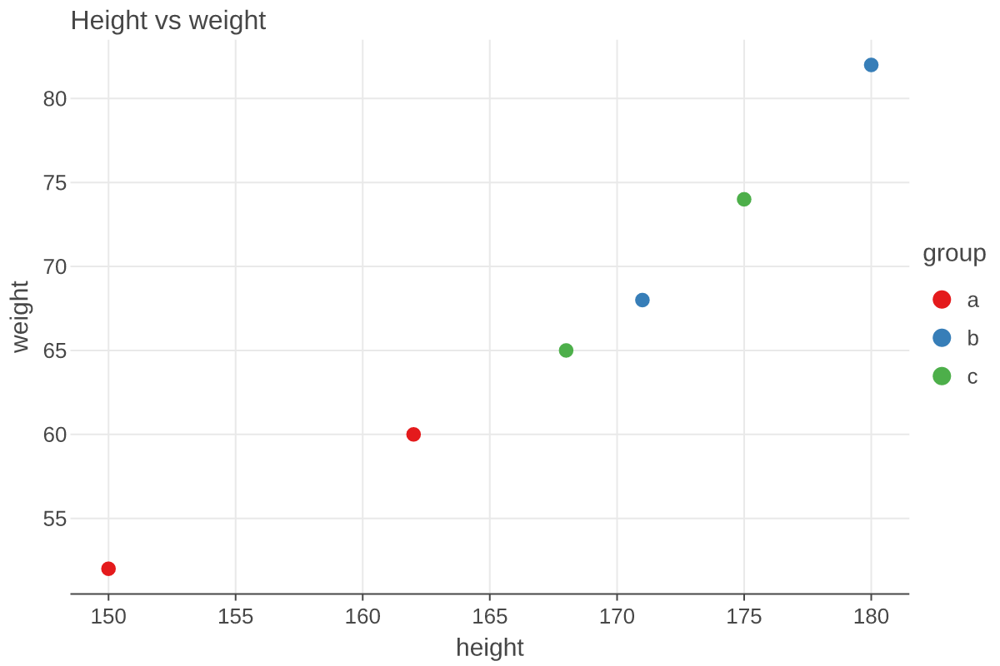
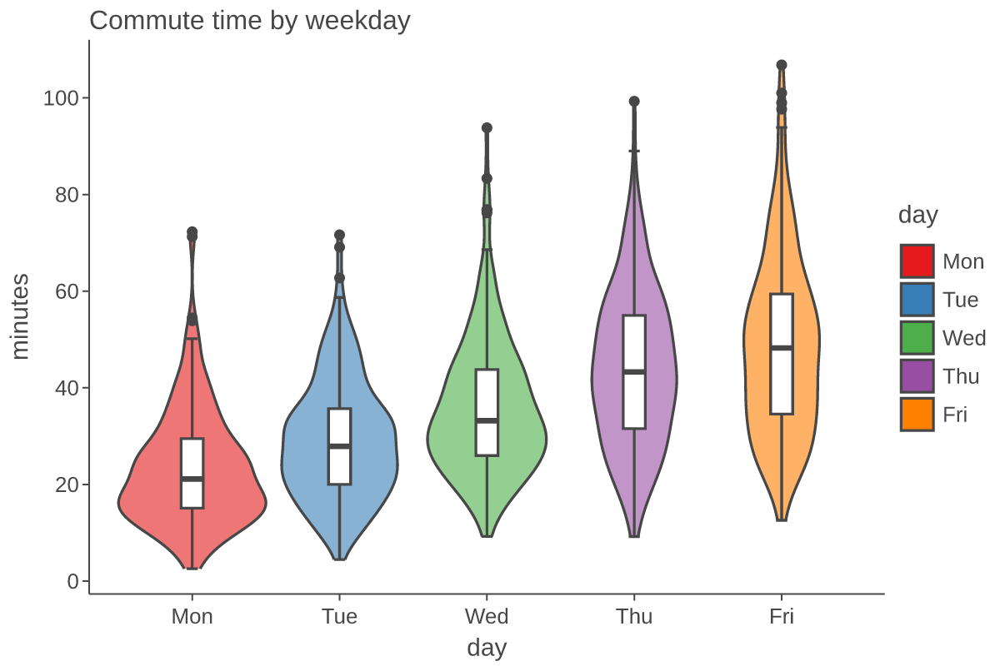
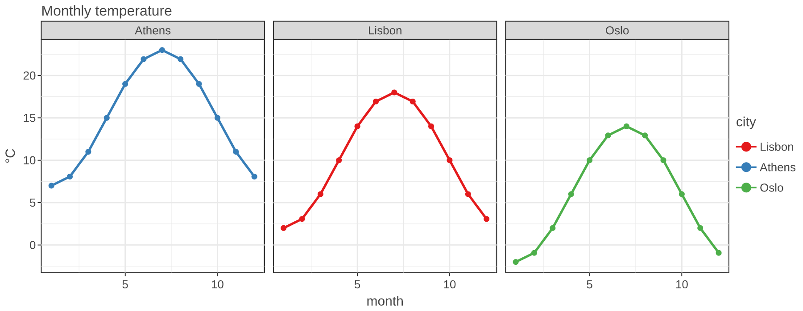
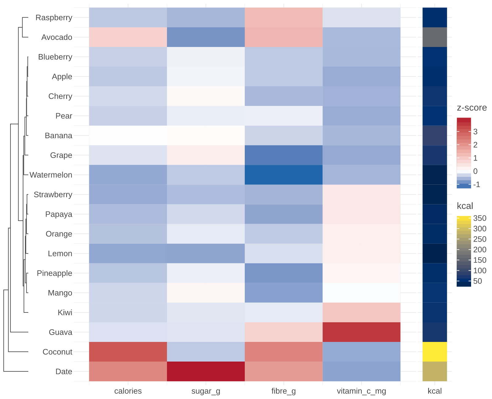
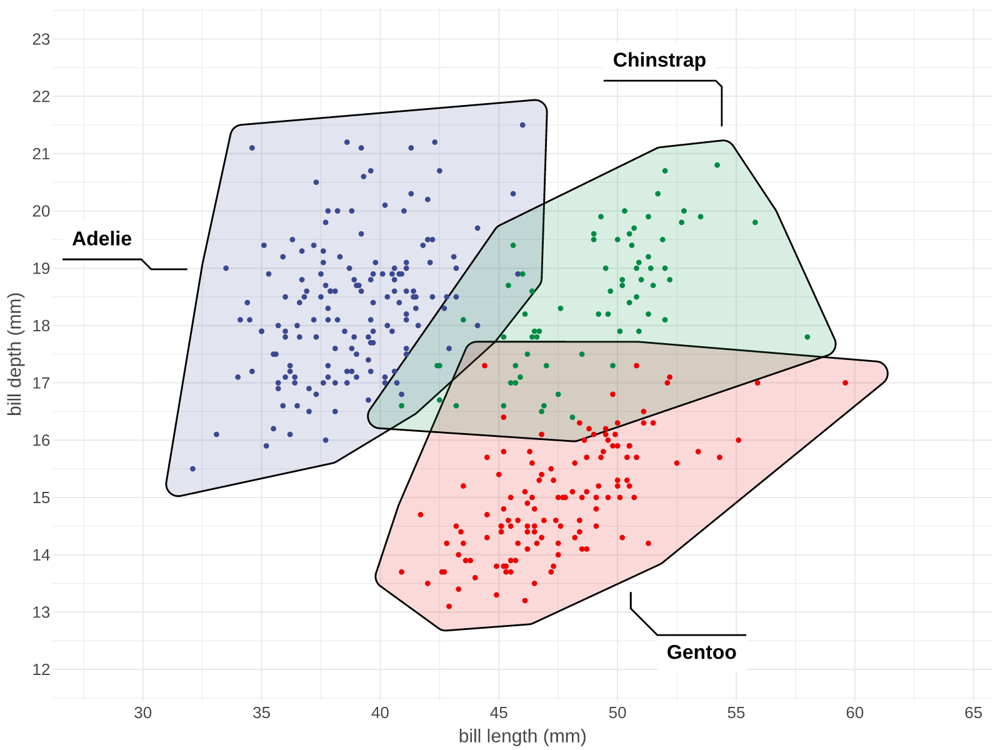
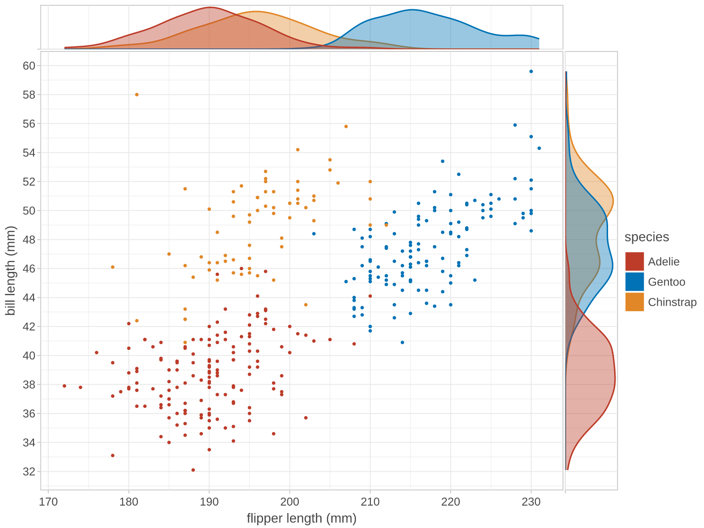
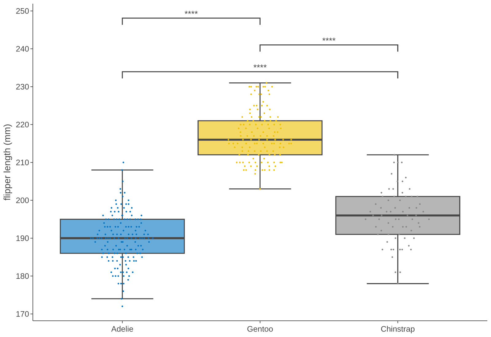
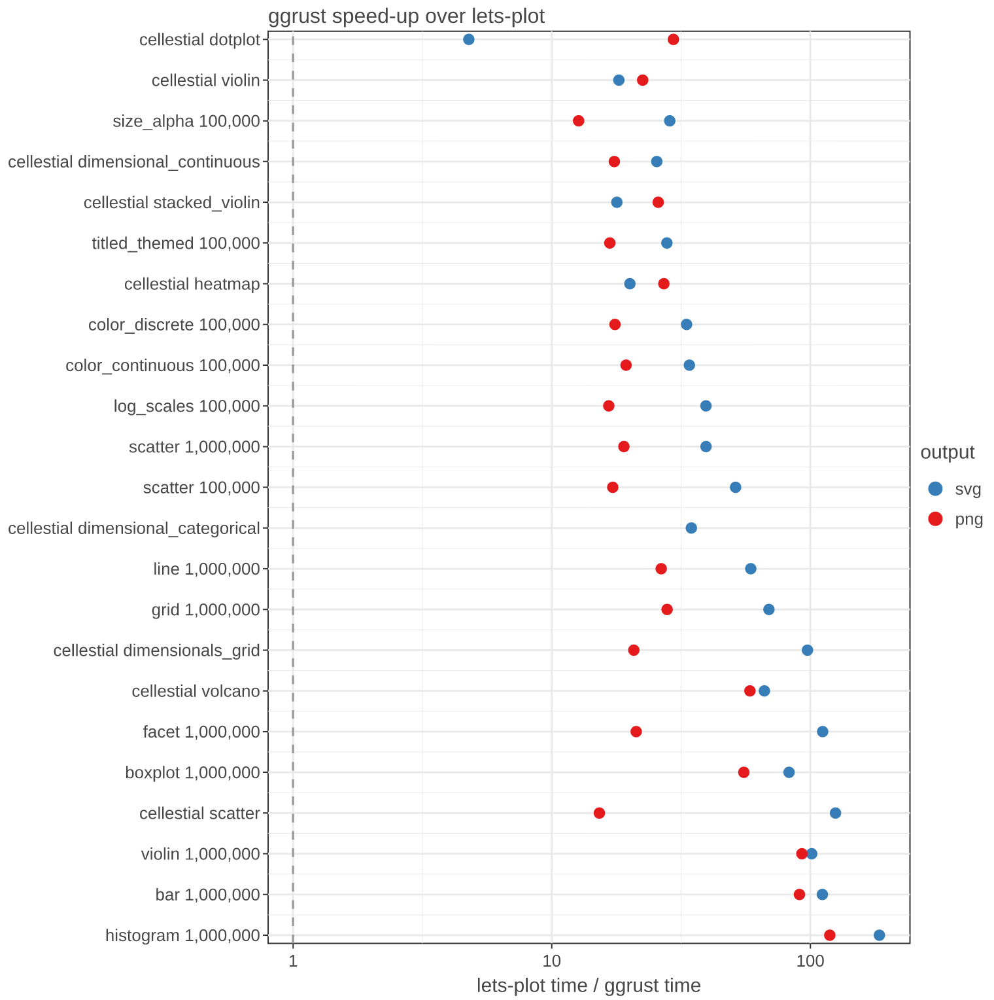
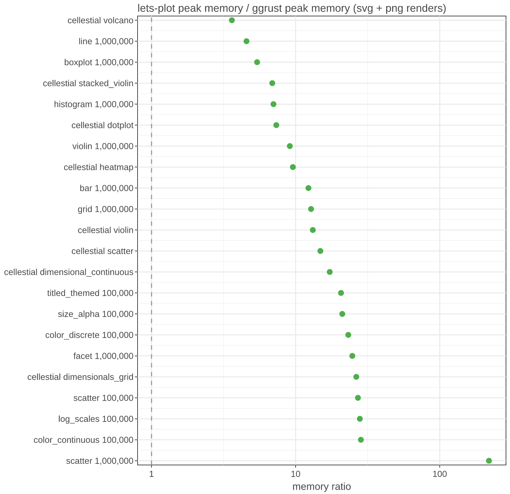

<p align="center">
  <picture>
    <source media="(prefers-color-scheme: dark)" srcset="https://raw.githubusercontent.com/datavil/ggrust/main/assets/logo/ggrust-logo-dark.svg">
    
  </picture>
</p>

# ggrust

[](https://github.com/datavil/ggrust)
[](https://opensource.org/licenses/MIT)
[](https://ggrust.datavil.org/)

The __Grammar of Graphics__, written in Rust, used from Python.

__ggrust__ is a plotting library with a [Lets-Plot](https://lets-plot.org/) compatible Python API. Plots are built the familiar ggplot way, layer by layer with `+`, while the stats, scales, layout and rendering all run in Rust.

It was started for [Cellestial](https://github.com/datavil/cellestial), which needed a maintained backend for its Lets-Plot based API. For most code, switching is an import swap: `lets_plot` -> `ggrust`.

Data crosses into Rust once, as Arrow, so [Polars](https://pola.rs/) and pandas frames work directly.

## Installation

```bash
pip install ggrust
```

```bash
uv add ggrust
```

## Quickstart

```python
import polars as pl
from ggrust import *

frame = pl.DataFrame(
    {
        "height": [150, 162, 171, 180, 168, 175],
        "weight": [52, 60, 68, 82, 65, 74],
        "group": ["a", "a", "b", "b", "c", "c"],
    }
)

plot = (
    ggplot(frame, aes(x="height", y="weight", color="group"))
    + geom_point(size=4)
    + labs(title="Height vs weight")
    + ggsize(600, 400)
)

plot.to_png("plot.png")
```

<p align="center">
  
</p>

In a notebook the plot shows as interactive HTML (tooltips, zoom and pan with `ggtb()`).

## Examples

### Distributions

Violins with boxplots on top, using the same layering as ggplot.

<details>
<summary><b>Show code</b></summary>

```python
import numpy as np

rng = np.random.default_rng(0)
days = ["Mon", "Tue", "Wed", "Thu", "Fri"]
commute = pl.DataFrame(
    {
        "day": np.repeat(days, 200),
        "minutes": np.concatenate([rng.gamma(4 + i, 6, 200) for i in range(5)]),
    }
)

(
    ggplot(commute, aes(x="day", y="minutes", fill="day"))
    + geom_violin(alpha=0.6)
    + geom_boxplot(width=0.15, fill="white")
    + labs(title="Commute time by weekday")
    + theme_classic()
    + ggsize(600, 400)
)
```

</details>

<p align="center">
  
</p>

### Facets

Split a plot into panels by a column.

<details>
<summary><b>Show code</b></summary>

```python
months = np.arange(1, 13)
temperature = pl.DataFrame(
    {
        "month": np.tile(months, 3),
        "temp": np.concatenate(
            [10 + 8 * np.sin((months - 3) / 12 * 2 * np.pi) + offset for offset in (0, 5, -4)]
        ),
        "city": np.repeat(["Lisbon", "Athens", "Oslo"], 12),
    }
)

(
    ggplot(temperature, aes(x="month", y="temp", color="city"))
    + geom_line(size=1.2)
    + geom_point()
    + facet_wrap("city", ncol=3)
    + labs(title="Monthly temperature", y="°C")
    + theme_bw()
    + ggsize(900, 350)
)
```

</details>

<p align="center">
  
</p>

## What it covers

- __Geoms__: point, line, path, bar, col, histogram, boxplot, violin, area ridges, tile, raster, rect, text, label, text/label repel, segment, curve, polygon, rug, imshow, brackets and more.
- __Stats__: count, bin, density, smooth, summary, ecdf, contours, 2D bins, ellipses.
- __Scales__: continuous, discrete, log, reversed, datetime, hue, manual, gradients, viridis, brewer, secondary axes, axes on any side.
- __Layout__: `facet_wrap`, `facet_grid`, `gggrid` with collected legends, `coord_fixed`, `coord_flip`, themes (`theme_classic`, `theme_bw`, `theme_minimal`, `theme_void`, ...).
- __Outputs__: SVG, PNG, vector PDF, and interactive HTML through `ggsave`, with your own fonts (`register_font`). Dense scatter layers are drawn on a canvas in HTML.

ggrust is a __subset__ of Lets-Plot, not all of it. Features follow what Cellestial and everyday plotting need. See the [migration note](https://ggrust.datavil.org/migration/) for the differences.

## ggplot2 extensions, built in

Many popular ggplot2 extension packages from R are built into ggrust, under their R function names. Nothing extra to install; Lets-Plot has none of them.

| Feature | ggrust | From the R package |
|---|---|---|
| Beeswarm and quasirandom points | `geom_beeswarm`, `geom_quasirandom` | [ggbeeswarm](https://cran.r-project.org/package=ggbeeswarm) |
| Journal color palettes | `scale_color_npg`, `_aaas`, `_nejm`, `_lancet`, `_jama`, `_jco`, `_d3`, `_igv` | [ggsci](https://cran.r-project.org/package=ggsci) |
| Significance tests and labels | `stat_compare_means`, `stat_cor`, `stat_poly_eq` | [ggpubr](https://cran.r-project.org/package=ggpubr), [ggpmisc](https://cran.r-project.org/package=ggpmisc) |
| Cluster marks | `geom_mark_hull`, `geom_mark_ellipse`, `geom_mark_rect` | [ggforce](https://cran.r-project.org/package=ggforce) |
| Highlighting | `gghighlight` | [gghighlight](https://cran.r-project.org/package=gghighlight) |
| Point density | `geom_pointdensity` | [ggpointdensity](https://cran.r-project.org/package=ggpointdensity) |
| Side panels | `geom_xside*`, `geom_yside*`, `ggmarginal` | [ggside](https://cran.r-project.org/package=ggside) |
| Several color scales in one plot | `new_scale_fill`, `new_scale_color`, `new_scale` | [ggnewscale](https://cran.r-project.org/package=ggnewscale) |
| Dendrograms | `hclust`, `scale_x_dendro`, `scale_y_dendro`, `geom_dendrogram` | [legendry](https://cran.r-project.org/package=legendry), [ggh4x](https://cran.r-project.org/package=ggh4x), [ggdendro](https://cran.r-project.org/package=ggdendro) |
| Raincloud plots | `stat_halfeye`, `stat_interval`, `geom_half_violin`, `geom_half_boxplot`, `geom_half_point` | [ggdist](https://cran.r-project.org/package=ggdist), [gghalves](https://cran.r-project.org/package=gghalves) |
| Figure layouts and panel tags | `gggrid(design=, tag_levels=)`, `inset_element` | [patchwork](https://cran.r-project.org/package=patchwork) |
| Rasterized layers in vector output | `rasterize` | [ggrastr](https://cran.r-project.org/package=ggrastr), [scattermore](https://cran.r-project.org/package=scattermore) |

ggrust reimplements their behavior in Rust; the R packages and their authors designed it. Examples and credits are in the [extensions guide](https://ggrust.datavil.org/guide/extensions/).

<p align="center">
  
  
  
  
</p>

## Performance

Compared with Lets-Plot on identical work: same data, every row drawn (Lets-Plot sampling turned off), same output size. Measured on an Apple M4 Pro, ggrust 0.1.0 vs lets-plot 4.11.0.

- __Speed__: SVG a median __40x__ faster (5x to 185x over 23 cases), PNG a median __22x__ faster (13x to 119x).
- __Memory__: a median __14x__ lower peak memory (3.6x to 220x). A 1M-point scatter PNG peaks at 44 MB above the data in ggrust and 9.6 GB in Lets-Plot.
- No case was slower. The weakest spots are point-heavy PNGs (13x to 21x) and large SVGs, where ggrust still peaks at 430 MB for 1M points.

<p align="center">
  
  
</p>

Full methodology, raw numbers and side-by-side output images are in the [benchmark report](benchmarks/REPORT.md).

## Status

Early, but usable: the full Cellestial test suite passes on ggrust. Expect rough edges and API gaps; issues are welcome.

## Development

```bash
uv sync          # create the dev environment
make develop     # build the Rust extension into .venv
make check       # fmt, clippy, ruff, cargo test, pytest
```

Roadmap in [plan.md](plan.md), contributor rules in [AGENTS.md](AGENTS.md).
