<p align="center">
  <picture>
    <source media="(prefers-color-scheme: dark)" srcset="https://raw.githubusercontent.com/datavil/ggrust/main/assets/logo/ggrust-logo-dark.svg">
    
  </picture>
</p>

# ggrust

[](https://github.com/datavil/ggrust)
[](https://opensource.org/licenses/MIT)
[](https://ggrust.datavil.org/)
[](https://doi.org/10.5281/zenodo.24247772)

The __Grammar of Graphics__, written in Rust, used from Python.

<p align="center">
  <a href="https://ggrust.datavil.org/benchmarks/">
    <picture>
      <source media="(prefers-color-scheme: dark)" srcset="https://raw.githubusercontent.com/datavil/ggrust/main/docs/images/benchmarks/headline-dark.png">
      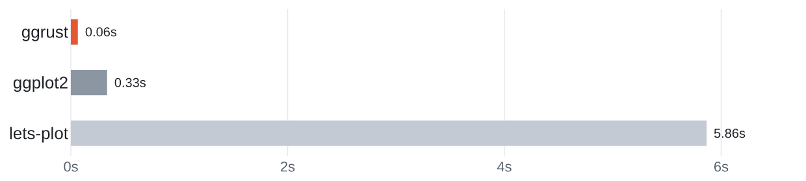
    </picture>
  </a>
</p>

<p align="center"><i>Median time to render one of 11 everyday plots with 1M rows, as SVG and PNG (<a href="https://ggrust.datavil.org/benchmarks/">benchmarks</a>).</i></p>

__ggrust__ is a plotting library with a [Lets-Plot](https://lets-plot.org/) compatible Python API. Plots are built the familiar ggplot way, layer by layer with `+`, while the stats, scales, layout and rendering all run in Rust.

It was started for [Cellestial](https://github.com/datavil/cellestial), which needed a maintained backend for its Lets-Plot based API.

<p align="center">
  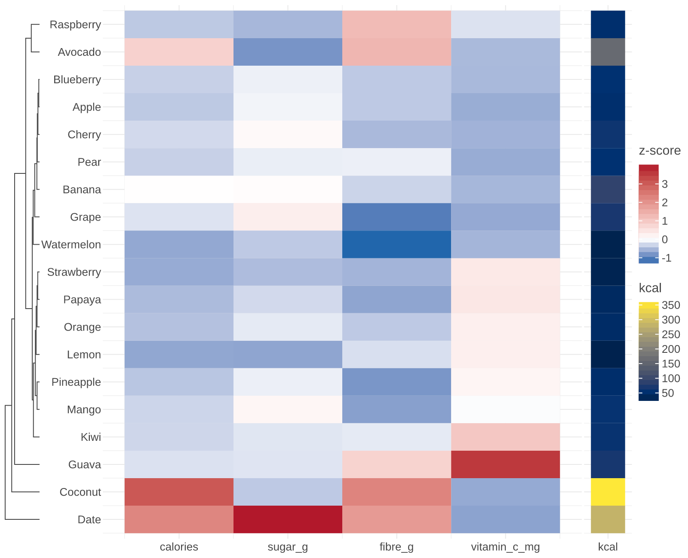
  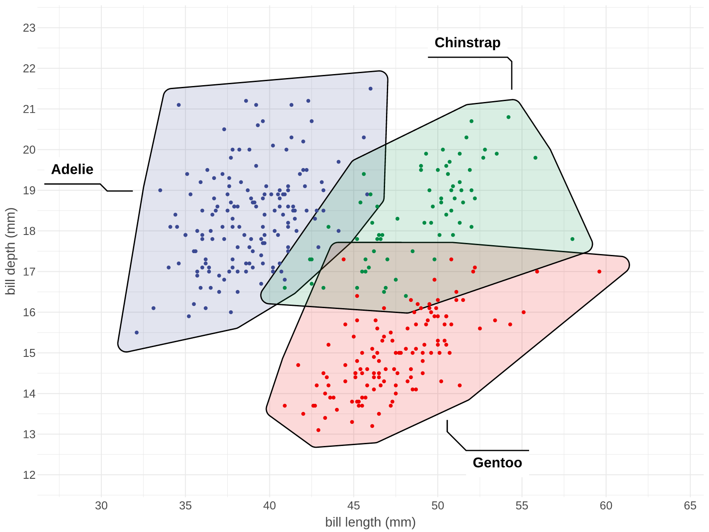
  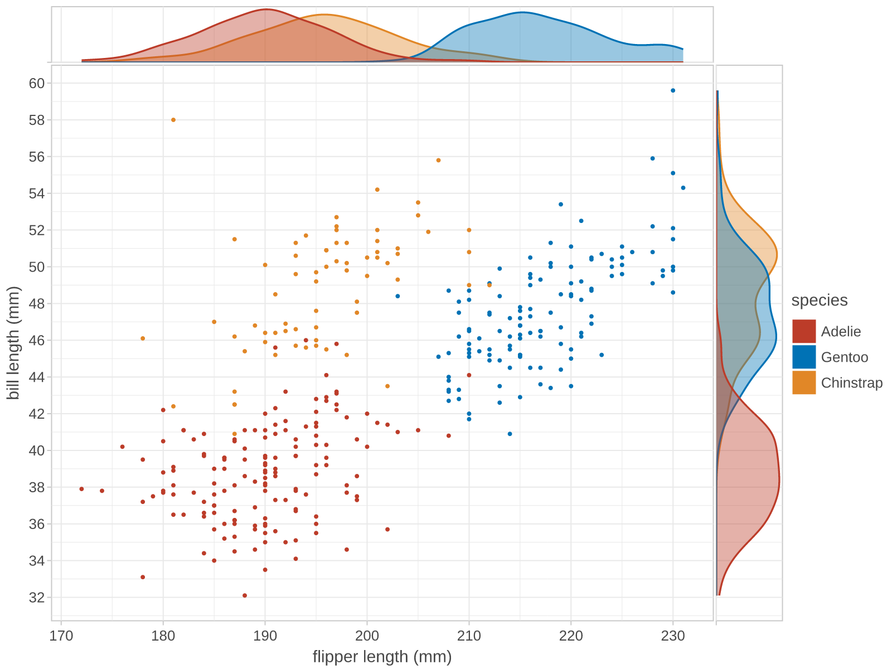
  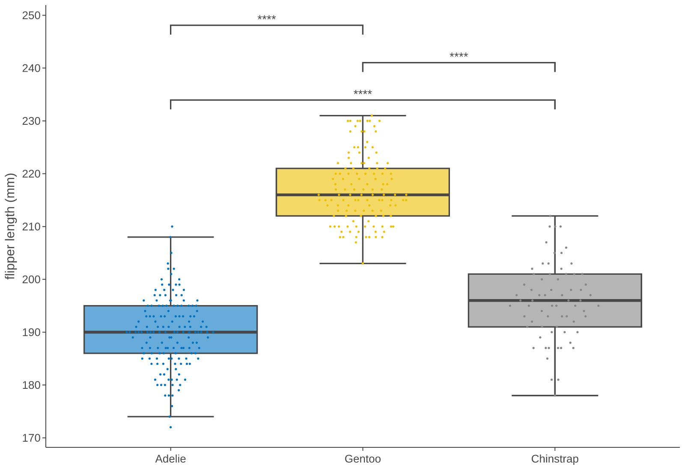
</p>

<p align="center"><i>Every plot above is ggrust. More in the <a href="https://ggrust.datavil.org/gallery/">gallery</a>.</i></p>

## Highlights

- __Fast and lean__: at 1M rows a typical plot renders __5x faster than ggplot2__ and __90x faster than Lets-Plot__, with 4x and 7.5x less memory ([benchmarks](#performance)).
- __ggplot2 extensions, built in__: beeswarms, significance brackets, cluster marks, side panels, dendrograms, raincloud plots, patchwork layouts and more, under their R names ([list](#ggplot2-extensions-built-in)).
- __The Lets-Plot API__: most code ports with an import swap, `lets_plot` -> `ggrust`.
- __Interactive__: notebook and HTML output with tooltips, zoom and pan; dense point layers drawn on a canvas.
- __Publication output__: SVG, PNG, vector PDF and HTML, with your own fonts. Data crosses into Rust once, as Arrow, so [Polars](https://pola.rs/) and pandas frames work directly.

## Installation

```bash
pip install ggrust
```

```bash
uv add ggrust
```

## Quickstart

```python
from ggrust import *
from ggrust.data import penguins

plot = (
    ggplot(penguins.drop_nulls(), aes("bill_length_mm", "bill_depth_mm"))
    + geom_smooth(method="lm", color="grey", linetype="dashed", se=False)
    + geom_point(aes(color="species"), size=2.5, alpha=0.7)
    + geom_smooth(aes(color="species", fill="species"), method="lm")
    + stat_cor(aes(color="species"), label_x_npc="right", label_y_npc="bottom")
    + scale_color_npg()
    + scale_fill_npg()
    + labs(
        title="Simpson's paradox in Palmer penguins",
        subtitle="Overall, longer bills look shallower (dashed). Within every species, the opposite.",
        x="bill length (mm)",
        y="bill depth (mm)",
    )
    + theme_classic()
    + ggsize(760, 500)
)

plot.to_png("plot.png")
```

<p align="center">
  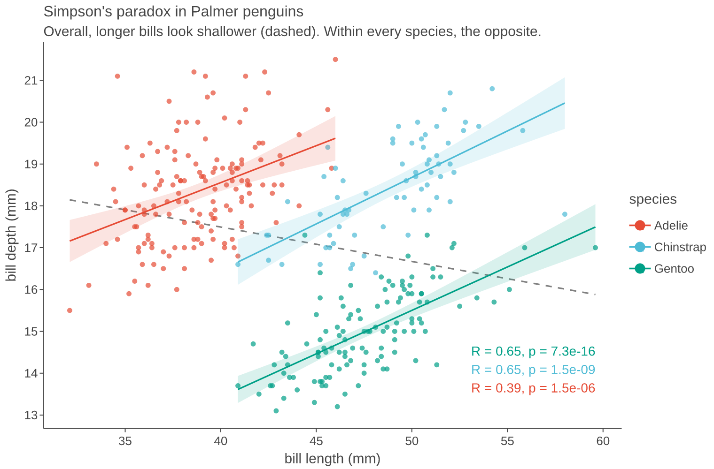
</p>

In a notebook the plot shows as interactive HTML (tooltips, zoom and pan with `ggtb()`).

## Showcase

From 3D surfaces to album covers, all drawn with the same `+` grammar.

### 3D surface

`geom_surface` under `coord_3d`. Neither Lets-Plot nor ggplot2 draws 3D.

<p align="center">
  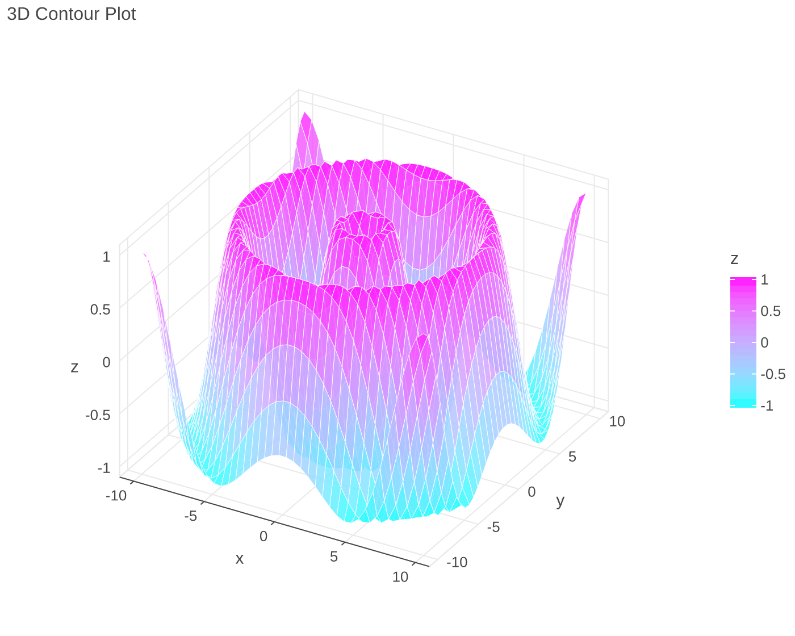
</p>

<details>
<summary><b>Show code</b></summary>

```python
import numpy as np
from ggrust import *

axis = np.linspace(-10, 10, 40)
x, y = np.meshgrid(axis, axis)
z = np.sin(np.sqrt(x**2 + y**2))
data = {"x": x.ravel(), "y": y.ravel(), "z": z.ravel()}

plot = (
    ggplot(data, aes("x", "y", z="z", fill="z"))
    + geom_surface(alpha=0.8)
    + scale_fill_gradient(low="#00FFFF", high="#FF00FF")
    + coord_3d()
    + ggtitle("3D Contour Plot")
    + ggsize(700, 560)
)
plot
```

</details>

### Funky heatmap

The scib single-cell integration benchmark, rebuilt from tiles, points, icons and labels.

<p align="center">
  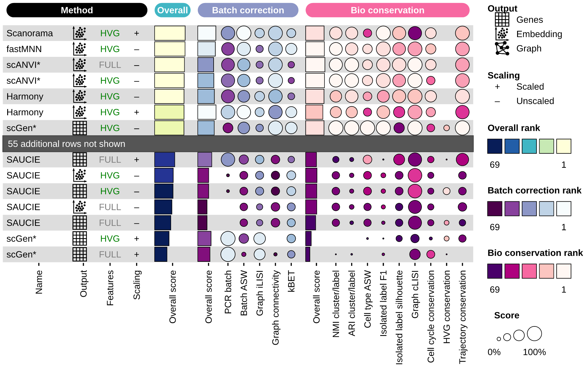
</p>

<details>
<summary><b>Show code</b></summary>

```python
import polars as pl
from ggrust import *
from ggrust.bistro import funky_heatmap, position_arguments

DATA = "https://raw.githubusercontent.com/datavil/ggrust/main/docs/data/"
runs = pl.read_csv(DATA + "scib_immune.csv")

batch = {
    "PCR_batch": "PCR batch",
    "ASW_label/batch": "Batch ASW",
    "iLISI": "Graph iLISI",
    "graph_conn": "Graph connectivity",
    "kBET": "kBET",
}
bio = {
    "NMI_cluster/label": "NMI cluster/label",
    "ARI_cluster/label": "ARI cluster/label",
    "ASW_label": "Cell type ASW",
    "isolated_label_F1": "Isolated label F1",
    "isolated_label_silhouette": "Isolated label silhouette",
    "cLISI": "Graph cLISI",
    "cell_cycle_conservation": "Cell cycle conservation",
    "hvg_overlap": "HVG conservation",
    "trajectory": "Trajectory conservation",
}
methods = {
    "scanorama": "Scanorama",
    "fastmnn": "fastMNN",
    "scanvi": "scANVI*",
    "harmony": "Harmony",
    "scgen": "scGen*",
    "saucie": "SAUCIE",
}
icons = {"full": "genes", "embed": "embedding", "knn": "graph"}


def rank_color(column: str) -> pl.Expr:
    """Rank 1 (best) -> 1.0 (lightest color), last -> 0.0."""
    rank = pl.col(column).rank("min", descending=True)
    return 1 - (rank - 1) / (rank.max() - 1)


scores = (
    runs.with_columns(
        (pl.col(name) - pl.col(name).min()) / (pl.col(name).max() - pl.col(name).min())
        for name in [*batch, *bio]
    )
    .with_columns(batch=pl.mean_horizontal(*batch), bio=pl.mean_horizontal(*bio))
    .with_columns(overall=0.4 * pl.col("batch") + 0.6 * pl.col("bio"))
    .with_columns(
        rank_color(name).alias(f"{name}_rank") for name in ["overall", "batch", "bio", *batch, *bio]
    )
    .sort("overall", descending=True)
    .with_columns(
        id=pl.int_range(pl.len()).cast(pl.String),
        name=pl.col("method").replace(methods),
        icon=DATA + "scib_icons/" + pl.col("output").replace_strict(icons) + ".png",
        features=pl.col("features").replace({"full_feature": "FULL", "hvg": "HVG"}),
        scaling=pl.col("scaling").replace({"scaled": "+", "unscaled": "\u2013"}),
    )
)
shown = pl.concat([scores.head(7), scores.tail(7)])
separator = pl.DataFrame({"id": ["hidden"]})
table = pl.concat([shown.head(7), separator, shown.tail(7)], how="diagonal_relaxed")


def score(column: str, name: str, geom: str, group: str) -> dict:
    """Describe a score column: its size from ``column``, its color from the rank."""
    width = 2.5 if group == "overall" else 1.5 if geom == "bar" else 1
    return {
        "id": column,
        "id_color": f"{column}_rank",
        "name": name,
        "geom": geom,
        "group": group,
        "palette": group,
        "draw_outline": False,
        "options": {"width": width},
    }


def method(column: str, name: str, geom: str, width: float, **options: object) -> dict:
    """Describe a method column."""
    return {
        "id": column,
        "name": name,
        "geom": geom,
        "group": "method",
        "options": {"width": width, **options},
    }


column_info = [
    method("name", "Name", "text", 4.5, hjust=0),
    method("icon", "Output", "image", 1.5),
    {**method("features", "Features", "text", 2), "palette": "features", "id_color": "features"},
    method("scaling", "Scaling", "text", 1.5),
    score("overall", "Overall score", "bar", "overall"),
    score("batch", "Overall score", "bar", "batch"),
    *[score(column, name, "circle", "batch") for column, name in batch.items()],
    score("bio", "Overall score", "bar", "bio"),
    *[score(column, name, "circle", "bio") for column, name in bio.items()],
]
column_groups = [
    {"header": "Method", "group": "method", "palette": "black"},
    {"header": "Overall", "group": "overall", "palette": "overall"},
    {"header": "Batch correction", "group": "batch", "palette": "batch"},
    {"header": "Bio conservation", "group": "bio", "palette": "bio"},
]


def brewer(codes: str) -> list[str]:
    """Colors from dark (rank 69) to light (rank 1)."""
    return ["#" + code for code in reversed(codes.split())]


palettes = {
    "black": ["black", "black"],
    "features": {"FULL": "#808080", "HVG": "#008000"},
    "overall": brewer("FFFFD9 EDF8B1 C7E9B4 7FCDBB 41B6C4 1D91C0 225EA8 253494 081D58"),
    "batch": brewer("F7FCFD E0ECF4 BFD3E6 9EBCDA 8C96C6 8C6BB1 88419D 810F7C 4D004B"),
    "bio": brewer("FFF7F3 FDE0DD FCC5C0 FA9FB5 F768A1 DD3497 AE017E 7A0177 49006A"),
}
ranks = ["69", "", "", "", "1"]
legends = [
    {
        "title": "Output",
        "geom": "image",
        "labels": [DATA + f"scib_icons/{icon}.png" for icon in icons.values()],
        "values": ["Genes", "Embedding", "Graph"],
    },
    {
        "title": "Scaling",
        "geom": "text",
        "labels": ["+", "\u2013"],
        "values": ["Scaled", "Unscaled"],
    },
    {"title": "Overall rank", "palette": "overall", "geom": "rect", "labels": ranks, "size": 1},
    {
        "title": "Batch correction rank",
        "palette": "batch",
        "geom": "rect",
        "labels": ranks,
        "size": 1,
    },
    {
        "title": "Bio conservation rank",
        "palette": "bio",
        "geom": "rect",
        "labels": ranks,
        "size": 1,
    },
    {"title": "Score", "geom": "circle", "labels": ["0%", "", "", "", "100%"], "color": "white"},
]

heatmap = funky_heatmap(
    table,
    column_info=column_info,
    column_groups=column_groups,
    palettes=palettes,
    legends=legends,
    position_args=position_arguments(
        col_annot_position="bottom",
        col_annot_angle=90,
        col_annot_offset=6,
        col_group_radius=0.5,
        legend_position="right",
        expand_xmax=1,
    ),
    scale_column=False,
    add_abc=False,
)

# The hidden runs: a dark band on the separator row (row 8 is centred at y = -8 x 1.1).
# Its x range is the row background: 0.25 past the first and last column (0.1, 32.3).
hidden = len(scores) - len(shown)
band = pl.DataFrame(
    {
        "xmin": [-0.15],
        "xmax": [32.55],
        "ymin": [-9.35],
        "ymax": [-8.25],
        "x": [0.2],
        "y": [-8.8],
        "label": [f"{hidden} additional rows not shown"],
    }
)
plot = (
    heatmap
    + geom_rect(
        aes(xmin="xmin", xmax="xmax", ymin="ymin", ymax="ymax"),
        data=band,
        fill="#555555",
        color=None,
    )
    + geom_text(aes(x="x", y="y", label="label"), data=band, color="white", hjust=0, size=7.6)
)
plot
```

</details>

### Periodic table

Tiles, text and a hand-placed legend: one `ggplot`, no images.

<p align="center">
  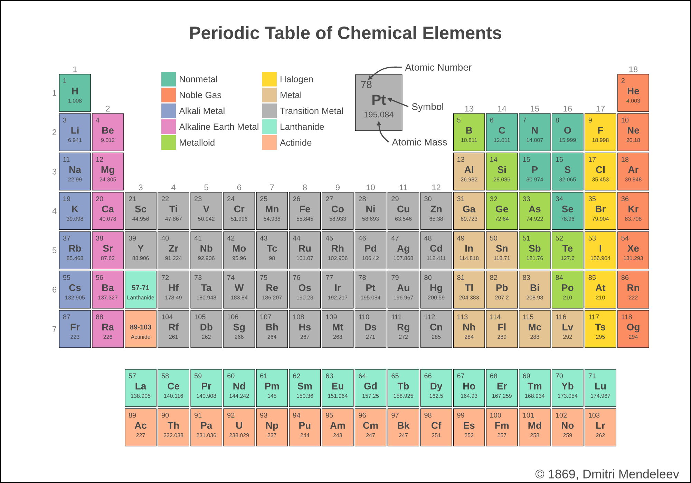
</p>

<details>
<summary><b>Show code</b></summary>

```python
import polars as pl
from ggrust import *

DATA = "https://raw.githubusercontent.com/datavil/ggrust/main/docs/data/"
elements = pl.read_csv(DATA + "elements.csv")

side = 0.95  # tile side, in table cells
key_ratio = 1.5  # the key tile is this much larger
key_x, key_y = 10.25, 1.25

# Lanthanides and actinides go in two rows below the table.
f_block = pl.col("type").is_in(["Lanthanide", "Actinide"])
main = elements.filter(~f_block).with_columns(x=pl.col("group"), y=pl.col("period"))
below = elements.filter(f_block).with_columns(
    x=pl.int_range(pl.len()) % 15 + 3, y=pl.col("period") + 2.5
)
table = pl.concat([main, below], how="vertical_relaxed")
placeholders = pl.DataFrame(
    {"x": [3, 3], "y": [6, 7], "type": ["Lanthanide", "Actinide"], "range": ["57-71", "89-103"]}
)
key = elements.filter(pl.col("atomic_number") == 78).with_columns(x=key_x, y=key_y)
groups = main.group_by("group").agg(y=pl.col("period").min())
periods = pl.DataFrame({"x": [0] * 7, "period": range(1, 8)})
notes = pl.DataFrame(
    {
        "x": [key_x + 0.8, key_x + 1, key_x + 0.4],
        "y": [key_y - 0.9, key_y + 0.1, key_y + 1],
        "label": ["Atomic Number", "Symbol", "Atomic Mass"],
    }
)
hover = (
    layer_tooltips()
    .title("@element\n(@type)")
    .line("Atomic number|@atomic_number")
    .line("Atomic mass|@atomic_mass")
    .line("Electrons|@electron_configuration")
)
head = arrow(angle=30, length=4, type="closed")

plot = (
    ggplot(mapping=aes("x", "y"))
    # The table: atomic number, symbol and mass on each tile.
    + geom_tile(
        aes(fill="type"),
        data=table,
        color="black",
        size=0.25,
        width=side,
        height=side,
        tooltips=hover,
    )
    + geom_text(
        aes(label="atomic_number"),
        data=table,
        nudge_x=-0.37,
        nudge_y=0.37,
        hjust="left",
        vjust="top",
        size=5,
    )
    + geom_text(aes(label="symbol"), data=table, nudge_y=0.05, size=7, fontface="bold")
    + geom_text(aes(label="atomic_mass"), data=table, nudge_y=-0.2, size=4, label_format=".3~f")
    # Where the lanthanides and actinides belong.
    + geom_tile(
        aes(fill="type"),
        data=placeholders,
        color="black",
        size=0.25,
        width=side,
        height=side,
        tooltips="none",
    )
    + geom_text(aes(label="range"), data=placeholders, nudge_y=0.05, size=5, fontface="bold")
    + geom_text(aes(label="type"), data=placeholders, nudge_y=-0.2, size=4)
    # The key: one larger tile with notes and arrows.
    + geom_tile(
        aes(fill="type"),
        data=key,
        color="black",
        size=0.25,
        width=key_ratio * side,
        height=key_ratio * side,
        tooltips="none",
    )
    + geom_text(
        aes(label="atomic_number"),
        data=key,
        nudge_x=-0.37 * key_ratio,
        nudge_y=0.37 * key_ratio,
        hjust="left",
        vjust="top",
        size=5 * key_ratio,
    )
    + geom_text(
        aes(label="symbol"), data=key, nudge_y=0.05 * key_ratio, size=7 * key_ratio, fontface="bold"
    )
    + geom_text(
        aes(label="atomic_mass"),
        data=key,
        nudge_y=-0.2 * key_ratio,
        size=4 * key_ratio,
        label_format=".3~f",
    )
    # Group and period numbers.
    + geom_text(
        aes("group", "y", label="group"),
        data=groups,
        color="gray",
        nudge_y=0.525,
        vjust="bottom",
        size=6,
    )
    + geom_text(
        aes("x", "period", label="period"), data=periods, color="gray", nudge_x=0.375, size=6
    )
    # Notes on the key.
    + geom_text(aes(label="label"), data=notes, hjust=0)
    + geom_curve(
        x=key_x + 0.7,
        y=key_y - 0.9,
        xend=key_x - 0.3,
        yend=key_y - 0.6,
        curvature=0.4,
        ncp=1,
        arrow=head,
    )
    + geom_segment(x=key_x + 0.9, y=key_y + 0.1, xend=key_x + 0.3, yend=key_y - 0.1, arrow=head)
    + geom_curve(
        x=key_x + 0.3,
        y=key_y + 1,
        xend=key_x,
        yend=key_y + 0.5,
        curvature=-0.4,
        ncp=1,
        arrow=head,
    )
    + scale_y_reverse()
    + scale_fill_brewer(name="", type="qual", palette="Set2", guide=guide_legend(ncol=2))
    + coord_fixed(ratio=1.2)
    + labs(title="Periodic Table of Chemical Elements", caption="© 1869, Dmitri Mendeleev")
    + theme_void()
    + theme(
        plot_title=element_text(size=26, face="bold", hjust=0.5, margin=[30, 0, 5, 0]),
        plot_caption=element_text(size=18),
        plot_background=element_rect(color="black", size=3),
        legend_position=[0.36, 0.85],
        legend_background="blank",
    )
    + ggsize(1000, 700)
)
plot
```

</details>

### Unknown Pleasures

Simulated pulsar pulses as stacked ridgelines, on a black theme.

<p align="center">
  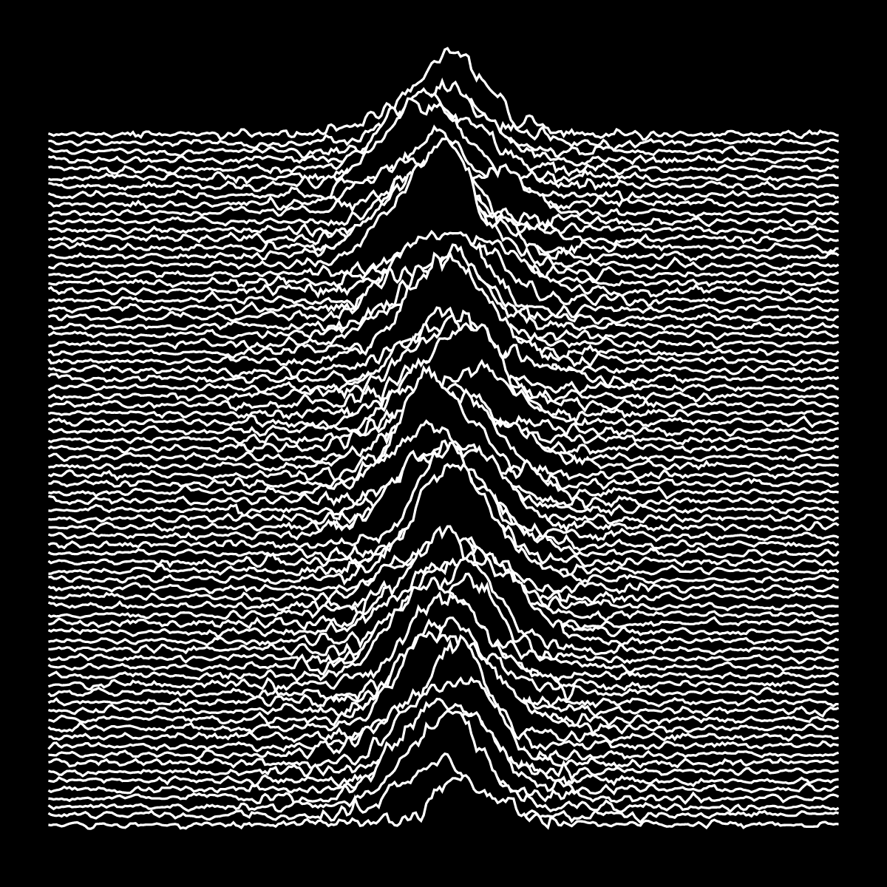
</p>

<details>
<summary><b>Show code</b></summary>

```python
import polars as pl
from ggrust import *

DATA = "https://raw.githubusercontent.com/datavil/ggrust/main/docs/data/"
pulses = pl.read_csv(DATA + "pulsar.csv", has_header=False)
signal = (
    pulses.with_row_index("pulse")
    .unpivot(index="pulse", variable_name="column", value_name="height")
    .with_columns(
        time=pl.col("column").str.strip_prefix("column_").cast(pl.Int64),
        height=pl.col("height") - pl.col("height").min(),
    )
)

plot = (
    ggplot(signal)
    + geom_area_ridges(
        aes("time", "pulse", height="height"),
        stat="identity",
        scale=0.25,
        color="white",
        fill="black",
    )
    + scale_y_reverse()
    + theme_minimal()
    + theme(axis="blank", panel_grid="blank")
    + flavor_high_contrast_dark()
    + ggsize(600, 600)
)
plot
```

</details>

### Ridgelines

Netflix movie durations by genre, filled by the genre mean on a log scale.

<p align="center">
  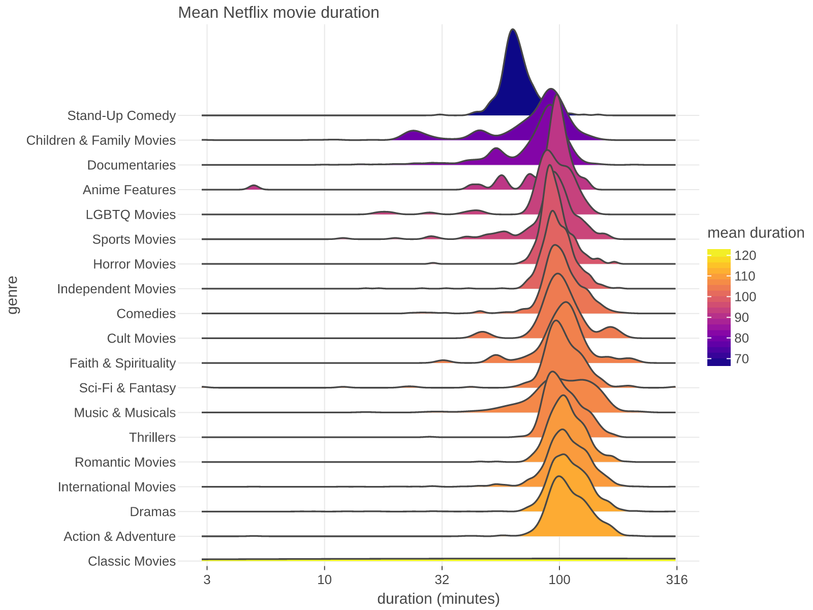
</p>

<details>
<summary><b>Show code</b></summary>

```python
import polars as pl
from ggrust import *

DATA = "https://raw.githubusercontent.com/datavil/ggrust/main/docs/data/"
movies = (
    pl.read_csv(DATA + "netflix.csv")
    .filter(pl.col("genres") != "Movies")
    .with_columns(genre=pl.col("genres").str.split(", "))
    .explode("genre", empty_as_null=True)
    .with_columns(mean_minutes=pl.col("minutes").mean().over("genre"))
    .sort("mean_minutes", descending=True)
)

plot = (
    ggplot(movies, aes("minutes", "genre"))
    + geom_area_ridges(
        aes(group="genre", fill="mean_minutes"),
        scale=4,
        tooltips=layer_tooltips().title("@genre").line("duration|@minutes min"),
    )
    + scale_x_log10("duration (minutes)")
    + scale_fill_viridis(name="mean duration", option="plasma")
    + ggtitle("Mean Netflix movie duration")
    + theme(axis_line_x="blank")
    + ggsize(800, 600)
)
plot
```

</details>

### Raincloud

Half violins, sina points and boxplots, on a solarized dark flavor.

<p align="center">
  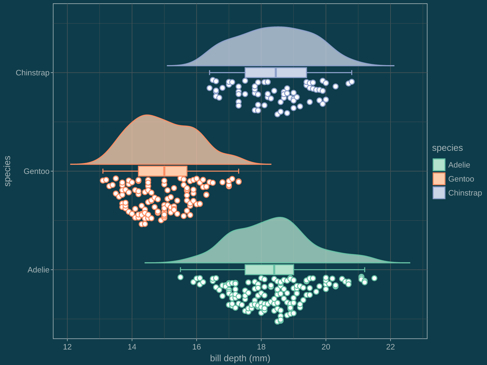
</p>

<details>
<summary><b>Show code</b></summary>

```python
import polars as pl
from ggrust import *

DATA = "https://raw.githubusercontent.com/datavil/ggrust/main/docs/data/"
penguins = pl.read_csv(DATA + "penguins.csv").drop_nulls("bill_depth_mm")

plot = (
    ggplot(penguins, aes("species", "bill_depth_mm", color="species", fill="species"))
    + geom_violin(show_half=1, alpha=0.75, trim=False, position=position_nudge(x=0.07))
    + geom_sina(
        show_half=-1,
        fill="white",
        shape=21,
        seed=42,
        show_legend=False,
        position=position_nudge(x=-0.07),
    )
    + geom_boxplot(width=0.1, outlier_alpha=0, show_legend=False)
    + scale_color_brewer(palette="Set2")
    + scale_fill_brewer(palette="Pastel2")
    + coord_flip()
    + ylab("bill depth (mm)")
    + theme_light()
    + flavor_solarized_dark()
    + ggsize(800, 600)
)
plot
```

</details>

<p align="center"><i>Over 40 more in the <a href="https://ggrust.datavil.org/gallery/">gallery</a>, including animations.</i></p>

## ggplot2 extensions, built in

Many popular ggplot2 extension packages from R are built into ggrust, under their R function names. Nothing extra to install; Lets-Plot has none of them.

| Feature | ggrust | From the R package |
|---|---|---|
| Beeswarm and quasirandom points | `geom_beeswarm`, `geom_quasirandom` | [ggbeeswarm](https://cran.r-project.org/package=ggbeeswarm) |
| Journal color palettes | `scale_color_npg`, `_aaas`, `_nejm`, `_lancet`, `_jama`, `_jco`, `_d3`, `_igv` | [ggsci](https://cran.r-project.org/package=ggsci) |
| Significance tests and labels | `stat_compare_means`, `stat_cor`, `stat_poly_eq` | [ggpubr](https://cran.r-project.org/package=ggpubr), [ggpmisc](https://cran.r-project.org/package=ggpmisc) |
| Cluster marks | `geom_mark_hull`, `geom_mark_ellipse`, `geom_mark_rect` | [ggforce](https://cran.r-project.org/package=ggforce) |
| Highlighting | `gghighlight` | [gghighlight](https://cran.r-project.org/package=gghighlight) |
| Point density | `geom_pointdensity` | [ggpointdensity](https://cran.r-project.org/package=ggpointdensity) |
| Side panels | `geom_xside*`, `geom_yside*`, `ggmarginal` | [ggside](https://cran.r-project.org/package=ggside) |
| Several color scales in one plot | `new_scale_fill`, `new_scale_color`, `new_scale` | [ggnewscale](https://cran.r-project.org/package=ggnewscale) |
| Dendrograms | `hclust`, `scale_x_dendro`, `scale_y_dendro`, `geom_dendrogram` | [legendry](https://cran.r-project.org/package=legendry), [ggh4x](https://cran.r-project.org/package=ggh4x), [ggdendro](https://cran.r-project.org/package=ggdendro) |
| Raincloud plots | `stat_halfeye`, `stat_interval`, `geom_half_violin`, `geom_half_boxplot`, `geom_half_point` | [ggdist](https://cran.r-project.org/package=ggdist), [gghalves](https://cran.r-project.org/package=gghalves) |
| Figure layouts and panel tags | `gggrid(design=, tag_levels=)`, `inset_element` | [patchwork](https://cran.r-project.org/package=patchwork) |
| Rasterized layers in vector output | `rasterize` | [ggrastr](https://cran.r-project.org/package=ggrastr), [scattermore](https://cran.r-project.org/package=scattermore) |

ggrust reimplements their behavior in Rust; the R packages and their authors designed it. Examples and credits are in the [extensions guide](https://ggrust.datavil.org/guide/extensions/).

## Performance

11 everyday plots (scatter, histogram, boxplot, violin, density, lm smooth, line, 2D bins, facets and more) at 10k, 100k and 1M rows, each saved as SVG and PNG. Same data, every row drawn (Lets-Plot's sampling turned off), same output size, each run in a fresh process. Apple M4 Pro; ggrust main (0.8.0 plus a line-drawing fix), R ggplot2 4.0.1 (svglite, ragg), lets-plot 4.11.0.

| 1M rows | SVG, all 11 plots | PNG, all 11 plots | peak memory per plot |
|---|---:|---:|---:|
| __ggrust__ | __0.91 s__ | __2.85 s__ | __138 MB__ |
| ggplot2 | 9.67 s (10.6x) | 25.0 s (8.8x) | 560 MB |
| Lets-Plot | 71.6 s (78.9x) | > 495 s (> 174x) | 1.0 GB |

- ggrust is faster than both in all 66 cases (11 plots x 3 sizes x 2 formats).
- Lets-Plot did not finish the 1M-row line PNG within 300 s; it counts as 300 s in its total.

Charts, rules and how to reproduce: the [benchmarks page](https://ggrust.datavil.org/benchmarks/). Raw numbers: [benchmarks/REPORT-three-way.md](benchmarks/REPORT-three-way.md).

## More examples

### Distributions

Violins with boxplots on top, using the same layering as ggplot.

<details>
<summary><b>Show code</b></summary>

```python
import numpy as np

rng = np.random.default_rng(0)
days = ["Mon", "Tue", "Wed", "Thu", "Fri"]
commute = pl.DataFrame(
    {
        "day": np.repeat(days, 200),
        "minutes": np.concatenate([rng.gamma(4 + i, 6, 200) for i in range(5)]),
    }
)

(
    ggplot(commute, aes(x="day", y="minutes", fill="day"))
    + geom_violin(alpha=0.6)
    + geom_boxplot(width=0.15, fill="white")
    + labs(title="Commute time by weekday")
    + theme_classic()
    + ggsize(600, 400)
)
```

</details>

<p align="center">
  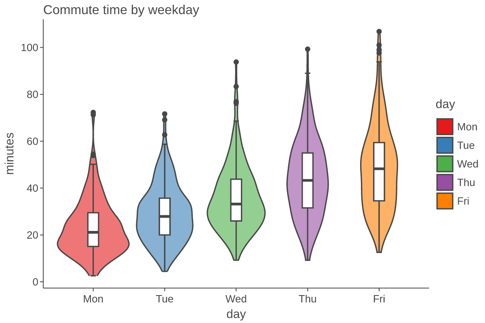
</p>

### Facets

Split a plot into panels by a column.

<details>
<summary><b>Show code</b></summary>

```python
months = np.arange(1, 13)
temperature = pl.DataFrame(
    {
        "month": np.tile(months, 3),
        "temp": np.concatenate(
            [10 + 8 * np.sin((months - 3) / 12 * 2 * np.pi) + offset for offset in (0, 5, -4)]
        ),
        "city": np.repeat(["Lisbon", "Athens", "Oslo"], 12),
    }
)

(
    ggplot(temperature, aes(x="month", y="temp", color="city"))
    + geom_line(size=1.2)
    + geom_point()
    + facet_wrap("city", ncol=3)
    + labs(title="Monthly temperature", y="°C")
    + theme_bw()
    + ggsize(900, 350)
)
```

</details>

<p align="center">
  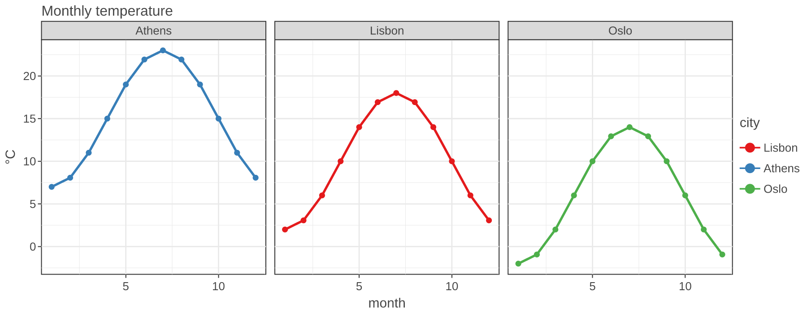
</p>

## What it covers

- __Geoms__: point, line, path, bar, col, histogram, boxplot, violin, area ridges, tile, raster, rect, text, label, text/label repel, segment, curve, polygon, rug, imshow, brackets and more.
- __Stats__: count, bin, density, smooth, summary, ecdf, contours, 2D bins, ellipses.
- __Scales__: continuous, discrete, log, reversed, datetime, hue, manual, gradients, viridis, brewer, secondary axes, axes on any side.
- __3D__: `coord_3d` with `geom_surface`, beyond both Lets-Plot and ggplot2.
- __Layout__: `facet_wrap`, `facet_grid`, `gggrid` with collected legends, `coord_fixed`, `coord_flip`, themes (`theme_classic`, `theme_bw`, `theme_minimal`, `theme_void`, ...).
- __Outputs__: SVG, PNG, vector PDF, and interactive HTML through `ggsave`, with your own fonts (`register_font`). Dense scatter layers are drawn on a canvas in HTML.

ggrust is a __subset__ of Lets-Plot, not all of it. Features follow what Cellestial and everyday plotting need. See the [migration note](https://ggrust.datavil.org/migration/) for the differences.

## Status

Stable from 1.0: names, signatures and error classes are frozen under semantic versioning, while the drawn output can still improve between minor releases (see the [stability policy](https://ggrust.datavil.org/guide/stability/)). Animation is provisional. The full Cellestial test suite passes on ggrust. It is a subset of Lets-Plot, so expect gaps; issues are welcome.

## Development

```bash
uv sync          # create the dev environment
make develop     # build the Rust extension into .venv
make check       # fmt, clippy, ruff, cargo test, pytest
```

Roadmap in [plan.md](plan.md), contributor rules in [AGENTS.md](AGENTS.md).
