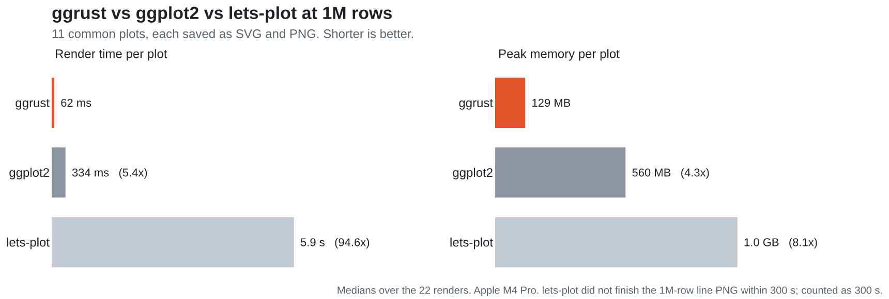
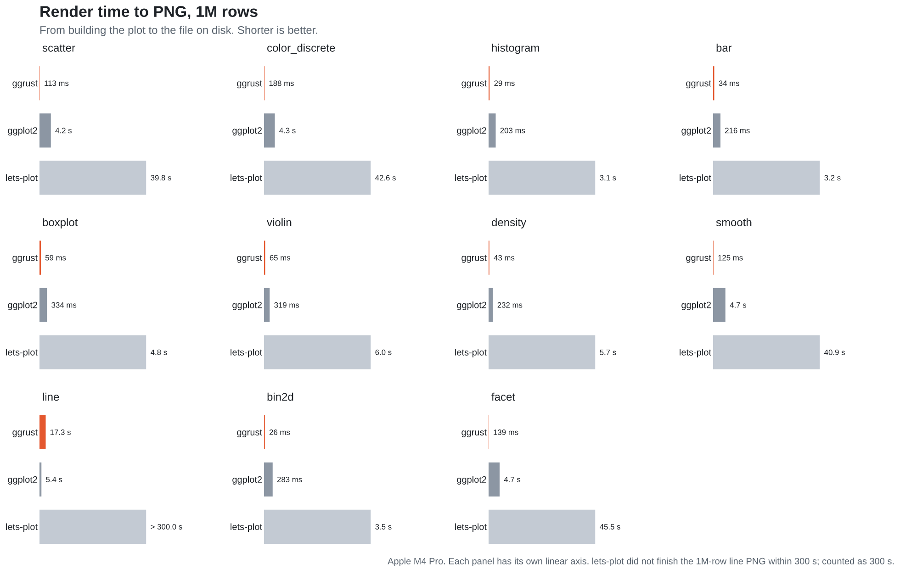
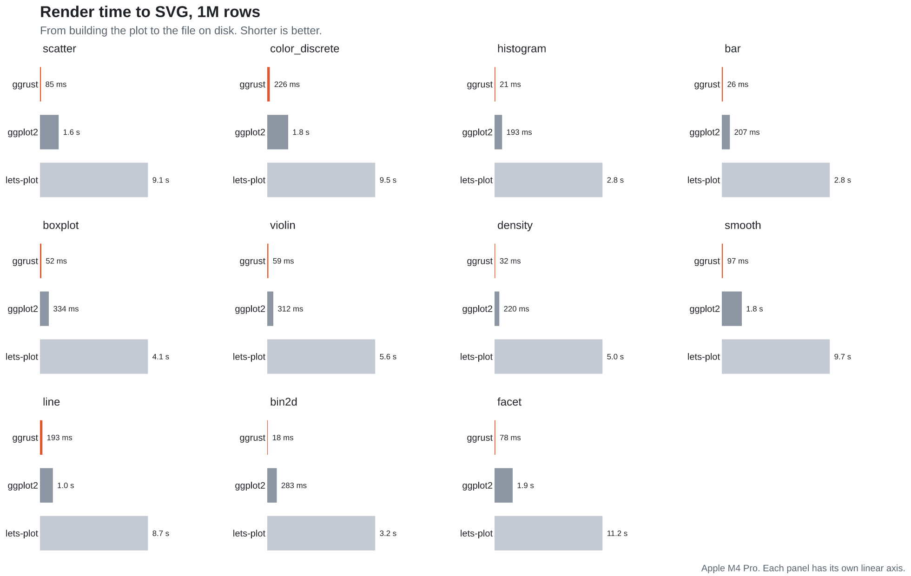
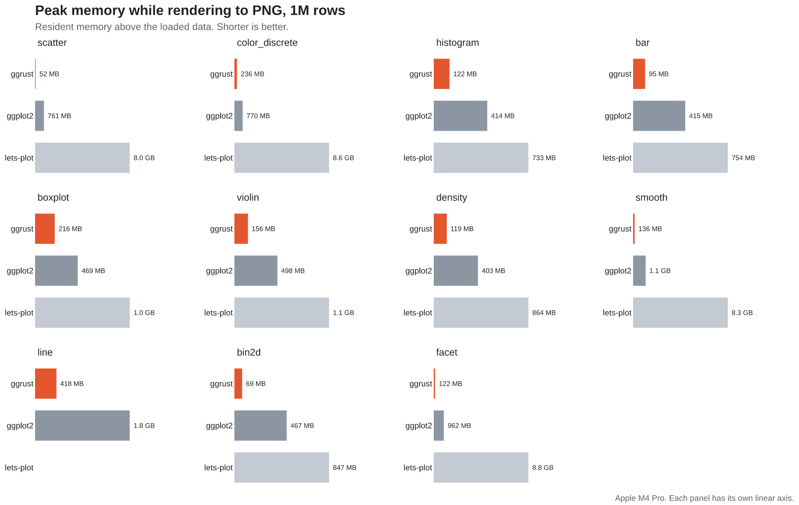
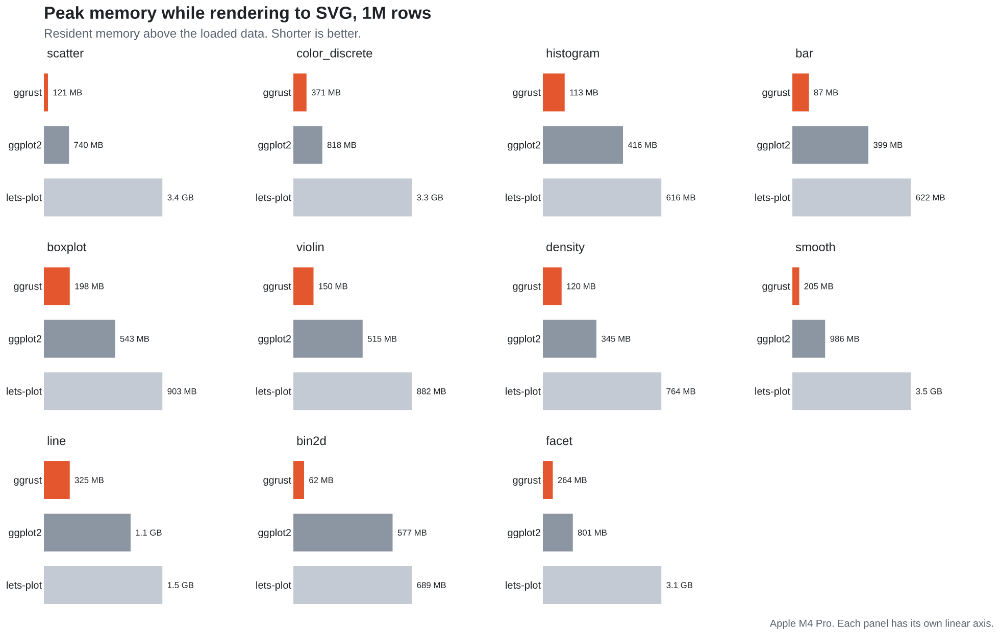
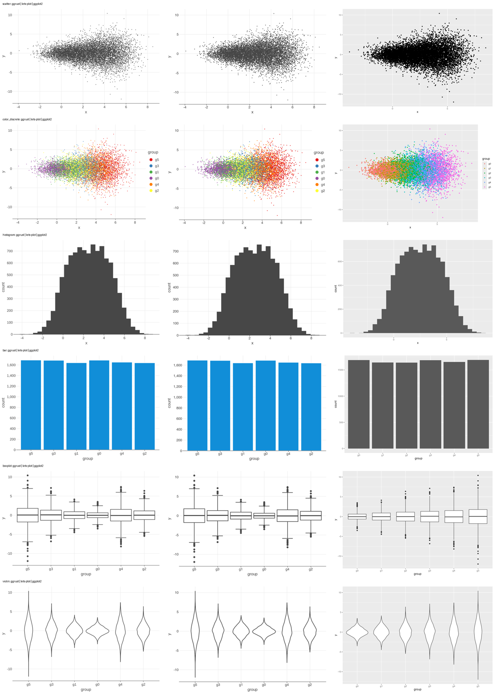
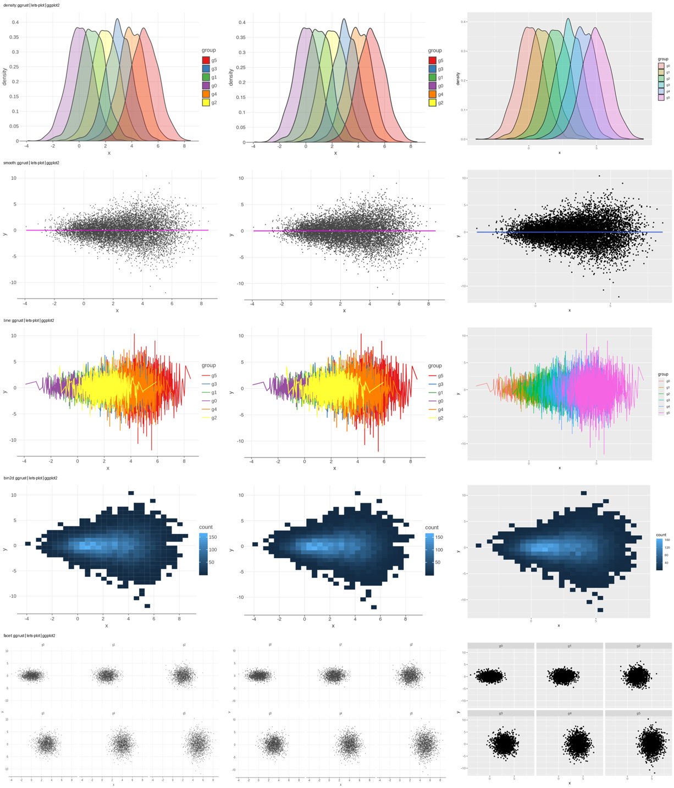

# ggrust vs lets-plot vs R ggplot2: benchmark report

Measured on 2026-11-08 at commit `9db79d3` (ggrust 0.8.0) plus the scripts
`three_way.py`, `three_way.R` and `three_way_charts.py`.

## Summary

11 common plot types, 3 sizes (10k, 100k, 1M rows), SVG and PNG, 66 cases per library.
Each number is the median warm render time, from building the plot to the file on disk.

| ggrust compared with | SVG speed-up, median (range) | PNG speed-up, median (range) | memory, median (range) |
|---|---:|---:|---:|
| lets-plot 4.11 | **68x** (26x to 176x) | **79x** (27x to 352x) | 4.8x lower SVG, 9.5x lower PNG |
| R ggplot2 4.0.1 | **20x** (5x to 80x) | **7.7x** (0.3x to 38x) | 3.6x lower SVG, 3.3x lower PNG |

- **ggrust is faster in 64 of 66 cases against ggplot2 and in every case against lets-plot.**
- **One real weakness: `geom_line` to PNG at large sizes.** 100k rows: ggrust 0.89 s,
  ggplot2 0.54 s. 1M rows: ggrust 17.3 s, ggplot2 5.4 s (lets-plot did not finish in 300 s).
  The same plot as SVG is 5x to 12x faster in ggrust than in ggplot2, so the slow part is
  rasterising long, self-overlapping polylines (6 lines of ~166k vertices zigzagging over
  the whole panel), not the stat or layout. This was known (plan 6.4 noted 12.1 s) and
  is the clearest optimisation target the benchmark found.
- **Point-heavy plots gain the most.** At 1M rows (scatter, smooth, facet) ggrust writes
  the PNG in 0.11 to 0.14 s, ggplot2 + ragg in 4.2 to 4.7 s (~35x), lets-plot in 40 to
  45 s (~330x).
- **Stat plots (histogram, bar, boxplot, violin, density, bin2d)** at 1M rows are 5x to
  16x faster than ggplot2 and 78x to 176x faster than lets-plot (all sizes: 5x to 73x and
  28x to 176x). This is where R comes closest: its stats are vectorised C and few marks
  are drawn.
- **Memory.** At 1M rows ggrust peaks 52 to 418 MB above the data, ggplot2 345 MB to
  1.9 GB, lets-plot 616 MB to 9 GB. The one case where ggrust uses more memory than ggplot2
  is the 10k-row facet PNG (42 MB vs 35 MB).
- **Ranking of the other two.** ggplot2 is a median 6.6x faster than lets-plot on the
  same work. lets-plot pays to serialise every row to JSON, and its PNG export is
  especially slow and memory-hungry (a 1M-point scatter PNG peaks at 8.0 GB).
- **Startup** (new process, import, one tiny PNG): ggrust 0.18 s, lets-plot 0.31 s,
  R 0.44 s (median of 6; first ggrust run 0.57 s, cold disk cache).











The same charts with context are on the docs site's [benchmarks page](https://ggrust.datavil.org/benchmarks/).

## Scenarios

The data looks like everyday data: `x` and `y` are shifted, widening normals, and `group`
has 6 levels (`g0` to `g5`). One CSV per size, shared by all three libraries.

| scenario | spec | what it stresses |
|---|---|---|
| scatter | `geom_point(size=1)` | marks: one per row |
| color_discrete | `geom_point(size=1)`, `color="group"` | marks + discrete scale + legend |
| histogram | `geom_histogram(bins=30)` | binning stat, few marks |
| bar | `geom_bar()` on `group` | counting stat, discrete axis |
| boxplot | `geom_boxplot()` by group | quantiles + outliers |
| violin | `geom_violin()` by group | KDE per group |
| density | `geom_density(alpha=0.3)`, `fill="group"` | KDE + transparent overlapping fills |
| smooth | points + `geom_smooth(method="lm")` | marks + model fit with SE band |
| line | `geom_line()`, `color="group"` | sort by x, very long polylines |
| bin2d | `geom_bin2d(bins=30)` | 2D binning + continuous fill scale |
| facet | points + `facet_wrap(~group, ncol=3)` | 6 panels, per-panel layout |

Visual check, 10k rows (columns: ggrust, lets-plot, ggplot2). The three libraries draw the
same data, bins, quantiles, densities, fits and panels. Style differences are each
library's defaults: ggplot2's grey theme, its larger points at `size=1`, smaller text at
this pixel size, and its alphabetical level order (lets-plot and ggrust use first
appearance).





## Methodology

**Machine.** Apple M4 Pro (12 cores), 24 GB RAM, macOS 27.0.1, Python 3.14.
**Versions.** ggrust 0.8.0 (release build), lets-plot 4.11.0, R 4.5.2 with ggplot2 4.0.1,
svglite 2.2.2, ragg 1.5.0, data.table for reading.

**Fair work.**
- Same data: one CSV per size, read by each library before timing starts (reading is
  not timed: polars in Python, `data.table::fread` in R).
- Every row drawn: lets-plot runs with `sampling="none"` on every layer (its default
  silently draws only 100k points; see `memory/letsplot_default_sampling.md`). ggrust and
  ggplot2 never sample.
- Same output: 600 x 400 px; PNG at scale 2 (1200 x 800 px). R uses the devices `ggsave`
  picks: `svglite` for SVG, `ragg::agg_png` (res 144) for PNG. Every library writes a file.
- Timed span: build the plot object, compute stats, lay out, render, write the file.
  For R that is `ggplot(...)` + `print(plot)` into the device + `dev.off()`.

**Fresh processes.** Each (library, scenario, size, format) runs in its own process, so
caches and heaps never carry over. Time: the first render is "cold", the reported number
is the median of the next three ("warm"); a configuration stops repeating after 30 s
in total. Timeout 300 s.

**Memory.** Each worker runs under `/usr/bin/time -l`. Memory = peak RSS of the process
minus its RSS after imports and data load (measured with `ps` the same way in Python
and R). So it covers what rendering allocates, including any one-time renderer setup
(lets-plot's PNG path costs ~200 MB even for a 10k-row histogram).

**Not measured.** Interactive HTML (lets-plot renders it in the browser, R has no
equivalent in ggplot2), notebook display, PDF.

**Reproduce.**

```bash
uv run python benchmarks/three_way.py --work /tmp/ggrust-bench     # ~45 min on an M4 Pro
uv run python benchmarks/three_way_charts.py benchmarks/results/three-way-<stamp>.json  # writes docs/images/benchmarks/
```

Raw results: `results/three-way-20261108-112228.json` (10k) and
`results/three-way-20261108-112328.json` (100k, 1M), with markdown tables next to them.

## Full results

Time in seconds (warm median), memory in MB above the data. Speed-ups are lets-plot or
ggplot2 time divided by ggrust time; below 1x means ggrust is slower.

| scenario | rows | format | ggrust s | lets-plot s | ggplot2 s | vs lets-plot | vs ggplot2 | ggrust MB | lets-plot MB | ggplot2 MB |
|---|---:|---|---:|---:|---:|---:|---:|---:|---:|---:|
| scatter | 10,000 | png | 0.008 | 0.624 | 0.096 | 82.1x | 12.6x | 21 | 250 | 30 |
| scatter | 10,000 | svg | 0.002 | 0.082 | 0.050 | 46.6x | 28.1x | 12 | 57 | 33 |
| color_discrete | 10,000 | png | 0.009 | 0.689 | 0.146 | 76.8x | 16.3x | 24 | 277 | 40 |
| color_discrete | 10,000 | svg | 0.003 | 0.088 | 0.099 | 26.3x | 29.3x | 15 | 57 | 44 |
| histogram | 10,000 | png | 0.011 | 0.313 | 0.054 | 27.9x | 4.9x | 22 | 200 | 26 |
| histogram | 10,000 | svg | 0.001 | 0.027 | 0.043 | 28.3x | 45.6x | 11 | 27 | 21 |
| bar | 10,000 | png | 0.009 | 0.336 | 0.056 | 37.4x | 6.2x | 22 | 199 | 22 |
| bar | 10,000 | svg | 0.001 | 0.027 | 0.045 | 31.0x | 51.7x | 11 | 27 | 22 |
| boxplot | 10,000 | png | 0.007 | 0.307 | 0.079 | 42.5x | 10.9x | 23 | 201 | 37 |
| boxplot | 10,000 | svg | 0.001 | 0.034 | 0.065 | 28.3x | 53.2x | 12 | 26 | 34 |
| violin | 10,000 | png | 0.011 | 0.641 | 0.080 | 58.2x | 7.3x | 23 | 218 | 62 |
| violin | 10,000 | svg | 0.004 | 0.202 | 0.066 | 45.5x | 14.9x | 14 | 32 | 49 |
| density | 10,000 | png | 0.015 | 0.907 | 0.114 | 61.2x | 7.7x | 24 | 213 | 38 |
| density | 10,000 | svg | 0.005 | 0.217 | 0.098 | 48.1x | 21.6x | 13 | 30 | 31 |
| smooth | 10,000 | png | 0.008 | 0.663 | 0.118 | 82.1x | 14.7x | 22 | 273 | 162 |
| smooth | 10,000 | svg | 0.002 | 0.088 | 0.073 | 45.6x | 37.6x | 12 | 54 | 163 |
| line | 10,000 | png | 0.044 | 2.167 | 0.147 | 49.0x | 3.3x | 22 | 216 | 71 |
| line | 10,000 | svg | 0.003 | 0.064 | 0.097 | 25.7x | 38.6x | 13 | 35 | 54 |
| bin2d | 10,000 | png | 0.008 | 0.311 | 0.093 | 40.8x | 12.2x | 21 | 202 | 34 |
| bin2d | 10,000 | svg | 0.001 | 0.031 | 0.081 | 28.3x | 72.9x | 11 | 26 | 25 |
| facet | 10,000 | png | 0.020 | 1.453 | 0.191 | 72.7x | 9.5x | 42 | 567 | 35 |
| facet | 10,000 | svg | 0.002 | 0.089 | 0.146 | 49.0x | 80.1x | 13 | 51 | 39 |
| scatter | 100,000 | png | 0.018 | 4.210 | 0.528 | 234.3x | 29.4x | 28 | 1300 | 163 |
| scatter | 100,000 | svg | 0.010 | 0.889 | 0.206 | 89.8x | 20.8x | 25 | 376 | 173 |
| color_discrete | 100,000 | png | 0.027 | 4.362 | 0.530 | 162.6x | 19.8x | 37 | 1326 | 104 |
| color_discrete | 100,000 | svg | 0.024 | 0.977 | 0.270 | 40.2x | 11.1x | 42 | 382 | 163 |
| histogram | 100,000 | png | 0.012 | 0.543 | 0.060 | 45.7x | 5.0x | 25 | 247 | 88 |
| histogram | 100,000 | svg | 0.002 | 0.253 | 0.048 | 106.3x | 20.2x | 15 | 77 | 70 |
| bar | 100,000 | png | 0.011 | 0.578 | 0.074 | 54.5x | 7.0x | 27 | 246 | 79 |
| bar | 100,000 | svg | 0.003 | 0.260 | 0.060 | 88.8x | 20.5x | 17 | 77 | 86 |
| boxplot | 100,000 | png | 0.014 | 0.632 | 0.093 | 45.2x | 6.7x | 39 | 248 | 110 |
| boxplot | 100,000 | svg | 0.006 | 0.338 | 0.077 | 57.3x | 13.1x | 27 | 104 | 65 |
| violin | 100,000 | png | 0.016 | 1.037 | 0.097 | 63.2x | 5.9x | 32 | 255 | 134 |
| violin | 100,000 | svg | 0.009 | 0.585 | 0.081 | 67.8x | 9.4x | 27 | 113 | 79 |
| density | 100,000 | png | 0.016 | 1.189 | 0.093 | 72.8x | 5.7x | 31 | 244 | 77 |
| density | 100,000 | svg | 0.006 | 0.505 | 0.076 | 79.9x | 12.0x | 25 | 94 | 92 |
| smooth | 100,000 | png | 0.019 | 4.064 | 0.558 | 212.9x | 29.2x | 31 | 1308 | 238 |
| smooth | 100,000 | svg | 0.010 | 0.890 | 0.272 | 85.9x | 26.2x | 27 | 378 | 251 |
| line | 100,000 | png | 0.890 | 24.128 | 0.539 | 27.1x | 0.6x | 101 | 380 | 372 |
| line | 100,000 | svg | 0.017 | 0.650 | 0.197 | 38.4x | 11.6x | 35 | 166 | 141 |
| bin2d | 100,000 | png | 0.010 | 0.552 | 0.092 | 56.6x | 9.4x | 27 | 248 | 133 |
| bin2d | 100,000 | svg | 0.002 | 0.267 | 0.081 | 112.8x | 34.2x | 15 | 81 | 70 |
| facet | 100,000 | png | 0.032 | 5.036 | 0.570 | 159.8x | 18.1x | 54 | 1640 | 209 |
| facet | 100,000 | svg | 0.007 | 0.931 | 0.291 | 130.2x | 40.7x | 38 | 343 | 141 |
| scatter | 1,000,000 | png | 0.113 | 39.790 | 4.247 | 351.7x | 37.5x | 52 | 8161 | 761 |
| scatter | 1,000,000 | svg | 0.085 | 9.071 | 1.571 | 106.3x | 18.4x | 121 | 3490 | 740 |
| color_discrete | 1,000,000 | png | 0.188 | 42.579 | 4.301 | 226.7x | 22.9x | 236 | 8857 | 770 |
| color_discrete | 1,000,000 | svg | 0.226 | 9.480 | 1.835 | 41.9x | 8.1x | 371 | 3357 | 818 |
| histogram | 1,000,000 | png | 0.029 | 3.054 | 0.203 | 103.6x | 6.9x | 122 | 733 | 414 |
| histogram | 1,000,000 | svg | 0.021 | 2.769 | 0.193 | 133.2x | 9.3x | 113 | 616 | 416 |
| bar | 1,000,000 | png | 0.034 | 3.162 | 0.216 | 93.2x | 6.4x | 95 | 754 | 415 |
| bar | 1,000,000 | svg | 0.026 | 2.799 | 0.207 | 105.9x | 7.8x | 87 | 622 | 399 |
| boxplot | 1,000,000 | png | 0.059 | 4.755 | 0.334 | 80.4x | 5.6x | 216 | 1040 | 469 |
| boxplot | 1,000,000 | svg | 0.052 | 4.065 | 0.334 | 78.2x | 6.4x | 198 | 903 | 543 |
| violin | 1,000,000 | png | 0.065 | 6.021 | 0.319 | 92.9x | 4.9x | 156 | 1096 | 498 |
| violin | 1,000,000 | svg | 0.059 | 5.602 | 0.312 | 95.2x | 5.3x | 150 | 882 | 515 |
| density | 1,000,000 | png | 0.043 | 5.708 | 0.232 | 133.1x | 5.4x | 119 | 864 | 403 |
| density | 1,000,000 | svg | 0.032 | 5.003 | 0.220 | 154.4x | 6.8x | 120 | 764 | 345 |
| smooth | 1,000,000 | png | 0.125 | 40.869 | 4.715 | 326.2x | 37.6x | 136 | 8457 | 1116 |
| smooth | 1,000,000 | svg | 0.097 | 9.688 | 1.787 | 99.5x | 18.3x | 205 | 3562 | 986 |
| line | 1,000,000 | png | 17.264 | >300 | 5.445 | - | 0.3x | 418 | >300 | 1854 |
| line | 1,000,000 | svg | 0.193 | 8.728 | 1.039 | 45.1x | 5.4x | 325 | 1489 | 1089 |
| bin2d | 1,000,000 | png | 0.026 | 3.523 | 0.283 | 135.9x | 10.9x | 69 | 847 | 467 |
| bin2d | 1,000,000 | svg | 0.018 | 3.197 | 0.283 | 176.0x | 15.6x | 62 | 689 | 577 |
| facet | 1,000,000 | png | 0.139 | 45.489 | 4.698 | 327.4x | 33.8x | 122 | 9023 | 962 |
| facet | 1,000,000 | svg | 0.078 | 11.229 | 1.887 | 143.3x | 24.1x | 264 | 3170 | 801 |