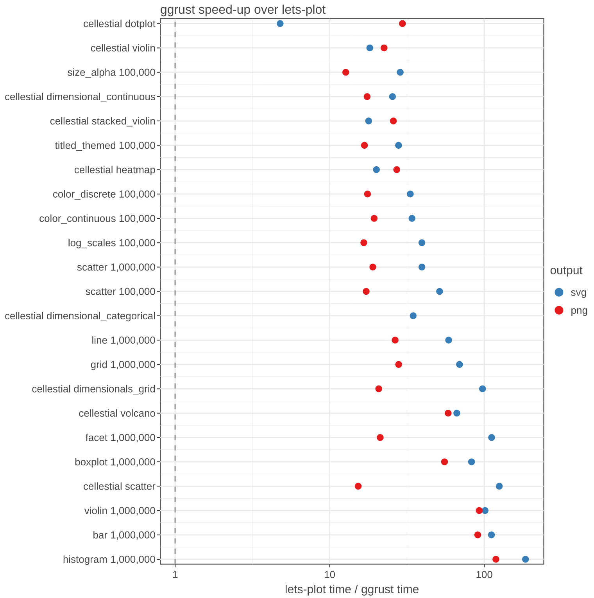
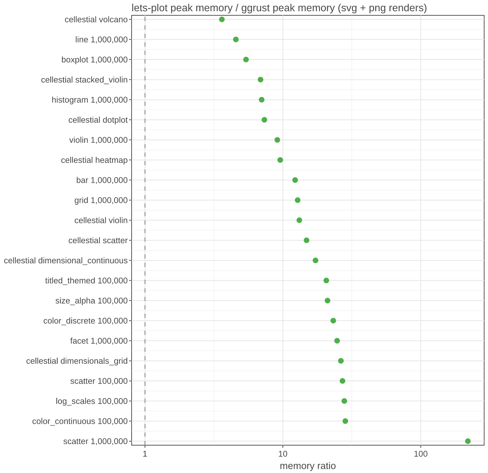
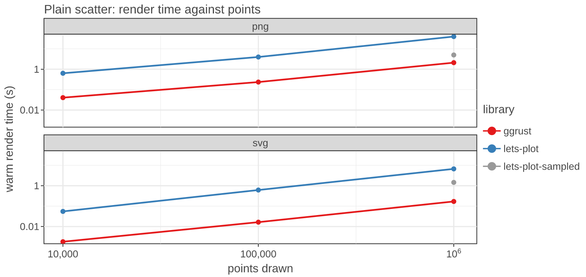

# ggrust vs lets-plot: benchmark report

Final report of plan step 6.4 (after the Phase 6 work: profiling, rayon, column cache).
Measured on 2026-10-31 at commit `528f556` plus this step's benchmark scripts.

## Summary

On identical work (same data, every row drawn, same output size), ggrust renders
**SVG a median 40x faster** (5x to 185x over 23 cases) and **PNG a median 22x faster**
(13x to 119x over 22 cases) than lets-plot, with a **median 14x lower peak memory**
(3.6x to 220x). No case is slower. The outputs look the same (side-by-side sheets below).





- **Every plot type gains.** Aggregating plots (histogram, bar, boxplot, violin) gain the
  most (55x to 185x at 1M rows): lets-plot serialises every input row to JSON before its
  stat runs, ggrust reads the Arrow buffers and only ever touches the stat output.
- **Point-heavy PNG gains the least (13x to 21x).** ggrust rasterises every marker as a
  tiny-skia path (~2 us per marker at 1M points). Plan items 6.1c (sprite stamping) and
  6.1f (fast deflate) target this.
- **Memory.** A 1M-point scatter PNG peaks 44 MB above the data in ggrust and 9.6 GB in
  lets-plot. ggrust's heaviest cases are large SVGs: the 1M-point scatter SVG alone peaks at
  430 MB (42 MB of SVG), and the 1M-row grid and line runs (SVG then PNG in one process)
  at 792 MB and 672 MB (lets-plot 10.1 GB and 3.1 GB). Plan item 6.1i.
  The memory ratio for `run.py` (scatter 1M, 220x) is the PNG process alone; every other case
  is the peak over both renders.
- **lets-plot's default sampling does not close the gap.** With its default (it silently
  draws only 100k of 1M points), lets-plot takes 1.45 s for the SVG and 4.98 s for the PNG;
  ggrust draws all 1M points in 0.17 s and 2.09 s.
- **cellestial**: all nine docstring examples are 5x to 125x faster (SVG) and 15x to 58x
  faster (PNG); lets-plot cannot export one of them (on-data legend) to PNG at all.



## Methodology

**Machine.** Apple M4 Pro (12 cores), 24 GB RAM, macOS 27.0.1, Python 3.14.7.
**Versions.** ggrust 0.1.0 (release build, `lto = "thin"`, `codegen-units = 1`),
lets-plot 4.11.0 (its bundled native exporter, no browser), polars 1.44.2, numpy 2.5.4.
cellestial runs in two environments with the same package versions: the `ggrust-port`
worktree (imports swapped to ggrust) and its poetry env on real lets_plot
(see `memory/cellestial_port_check.md`).

**Fairness rules** (AGENTS.md rule 8):

- Same polars frame (seeded numpy generator), same plot spec, same plot size, PNG at
  scale 2 for both (lets-plot's default).
- lets-plot runs with `sampling="none"` on every layer, so both libraries draw every row.
  By default lets-plot silently samples (points 100k, lines 50k, any layer 200k; see
  `memory/letsplot_default_sampling.md`). The one exception is `geom_boxplot`, which sets
  its own sampling: lets-plot samples the stat output (boxes and outliers), which stays far
  below every limit; at 300k rows both libraries draw the same outliers (2,059 vs 2,058).
  The default-sampled lets-plot is reported separately (`lets-plot-sampled`), never as the
  comparison.
- Every measurement runs in a fresh process. **Cold** is the first call (includes start-up
  work), **warm** the median of the following calls (3 repeats for the scatter sizes, 2 for
  scenarios, 5 for cellestial). lets-plot at 1M in `run.py` takes minutes and gets one warm
  call, so its 1M numbers are single measurements. Speed-ups and charts use warm times; cold times are within a few percent of warm
  for both libraries (raw files), except cellestial's first `build`, which loads its data.
- Timings in `scenarios.py` include building the spec (under 0.1 ms in both, lazy) and the
  render; `cellestial_examples.py` times the render of an already built plot.
- **Memory** is the peak resident set (`ru_maxrss`) above the level reached after building
  the data. It is cumulative within a process: in `scenarios.py` the reported peak covers
  both the SVG and the PNG renders; in `cellestial_examples.py` it is the peak of both
  renders above the build peak; `run.py` measures each output in its own process.
- HTML is not compared: lets-plot's HTML is a JSON spec rendered later in the browser,
  ggrust renders it in Rust, so the two numbers do not measure the same work.
- Visual parity: each scenario is rendered at 2,000 points by both libraries and stacked
  side by side (`benchmarks/compare_images.py`). Checked by eye for this report:
  `results/scenarios-20261031-161717-images/comparison.png` (scatter variants) and
  `results/scenarios-20261031-164621-images/comparison.png` (general plots).

**Suites.**

| script | what | sizes |
|---|---|---|
| `run.py` | plain scatter `geom_point(size=1)`, 600 x 400 | 10k, 100k, 1M |
| `scenarios.py` (scatter) | scatter, discrete / continuous colour, size + alpha, log scales, title + bottom legend | 10k, 100k |
| `scenarios.py` (general) | histogram (30 bins), bar (count), boxplot, violin, line (6 groups), `facet_wrap` (6 panels), 2x2 `gggrid` | 10k, 100k, 1M |
| `cellestial_examples.py` | nine cellestial docstring examples on pbmc3k (17,041 cells) | as written |

**Reproduce.**

```bash
uv run python benchmarks/run.py --timeout 1800
uv run python benchmarks/run.py --libraries lets-plot-sampled --sizes 1000000
uv run python benchmarks/scenarios.py
uv run python benchmarks/scenarios.py --scenarios histogram bar boxplot violin line facet grid --sizes 10000 100000 1000000 --timeout 2400
python benchmarks/cellestial_examples.py --ggrust-python <port venv python> --lets-plot-python <poetry env python>
uv run python benchmarks/report_charts.py
```

## Known costs and caveats

- **Line PNG at 1M points: 12.1 s** (lets-plot 322 s). Six 167k-vertex paths stroked by
  tiny-skia; the slowest ggrust render measured here.
- **Point PNG** is bounded by marker rasterisation (2.1 s for 1M points; lets-plot 39.8 s).
- **Large SVG memory**: 430 MB peak for the 1M-point scatter SVG (lets-plot 3.1 GB); up
  to 792 MB for the 1M-row grid over its SVG and PNG renders (lets-plot 10.1 GB).
- The lets-plot export runs in-process through its native library; a notebook user also
  pays the browser's rendering, which is not measured here for either library.
- ggrust's SVGs are mostly smaller than lets-plot's: up to 4.6x (1M-row facet: 42 MB vs
  156 MB), but 1.25x larger for cellestial stacked_violin (46 KB vs 37 KB). PNGs are 0.48x to
  1.9x lets-plot's size (deflate settings differ; parity is visual, not byte-level).

## Raw numbers

Raw JSON (every cold and warm time, output bytes, memory) and markdown tables:
`results/scatter-20261031-161436.*`, `results/scatter-20261031-161449.*` (default
sampling), `results/scenarios-20261031-161717.*`, `results/scenarios-20261031-164621.*`,
`results/cellestial-20261031-164951.*`.

### Plain scatter (`run.py`)

| output | points | library | cold (s) | warm (s) | peak memory above data (MB) |
|---|---:|---|---:|---:|---:|
| svg | 10,000 | ggrust | 0.003 | 0.002 | 13.2 |
| svg | 10,000 | lets-plot | 0.056 | 0.055 | 44.1 |
| svg | 100,000 | ggrust | 0.018 | 0.016 | 37.6 |
| svg | 100,000 | lets-plot | 0.596 | 0.615 | 315.4 |
| svg | 1,000,000 | ggrust | 0.173 | 0.169 | 429.8 |
| svg | 1,000,000 | lets-plot | 7.378 | 6.686 | 3118.2 |
| png | 10,000 | ggrust | 0.042 | 0.040 | 28.2 |
| png | 10,000 | lets-plot | 0.646 | 0.633 | 246.0 |
| png | 100,000 | ggrust | 0.237 | 0.235 | 30.8 |
| png | 100,000 | lets-plot | 3.952 | 3.966 | 1269.6 |
| png | 1,000,000 | ggrust | 2.097 | 2.092 | 43.6 |
| png | 1,000,000 | lets-plot | 39.567 | 39.779 | 9574.3 |

lets-plot with its default sampling (draws 100k of the 1M points):

| output | points | library | cold (s) | warm (s) | peak memory above data (MB) |
|---|---:|---|---:|---:|---:|
| svg | 1,000,000 | lets-plot-sampled | 1.430 | 1.452 | 501.0 |
| png | 1,000,000 | lets-plot-sampled | 4.825 | 4.980 | 1316.5 |

### Scatter scenarios (`scenarios.py`)

MB: peak memory above the data over the whole process (SVG and PNG renders).

| scenario | points | stage | ggrust (s) | lets-plot (s) | speed-up | ggrust MB | lets-plot MB | memory ratio |
|---|---:|---|---:|---:|---:|---:|---:|---:|
| color_continuous | 10,000 | svg | 0.0035 | 0.0972 | 28x | 13 | 53 | 4.1x |
| color_continuous | 10,000 | png | 0.0455 | 0.6944 | 15x | 26 | 284 | 10.7x |
| color_discrete | 10,000 | svg | 0.0032 | 0.0894 | 28x | 15 | 50 | 3.4x |
| color_discrete | 10,000 | png | 0.0456 | 0.6739 | 15x | 29 | 243 | 8.3x |
| log_scales | 10,000 | svg | 0.0025 | 0.0835 | 33x | 13 | 51 | 3.9x |
| log_scales | 10,000 | png | 0.0435 | 0.6240 | 14x | 27 | 250 | 9.3x |
| scatter | 10,000 | svg | 0.0021 | 0.0814 | 40x | 12 | 48 | 4.0x |
| scatter | 10,000 | png | 0.0391 | 0.6200 | 16x | 26 | 250 | 9.8x |
| size_alpha | 10,000 | svg | 0.0040 | 0.0972 | 24x | 14 | 54 | 3.9x |
| size_alpha | 10,000 | png | 0.1229 | 1.3623 | 11x | 27 | 288 | 10.7x |
| titled_themed | 10,000 | svg | 0.0040 | 0.0977 | 24x | 13 | 60 | 4.6x |
| titled_themed | 10,000 | png | 0.0498 | 0.7640 | 15x | 27 | 274 | 10.3x |
| color_continuous | 100,000 | svg | 0.0305 | 1.0390 | 34x | 35 | 431 | 12.3x |
| color_continuous | 100,000 | png | 0.2408 | 4.6671 | 19x | 50 | 1406 | 28.4x |
| color_discrete | 100,000 | svg | 0.0291 | 0.9674 | 33x | 42 | 413 | 9.9x |
| color_discrete | 100,000 | png | 0.2478 | 4.3528 | 18x | 55 | 1265 | 23.2x |
| log_scales | 100,000 | svg | 0.0232 | 0.9143 | 39x | 31 | 410 | 13.4x |
| log_scales | 100,000 | png | 0.2463 | 4.0927 | 17x | 43 | 1202 | 27.9x |
| scatter | 100,000 | svg | 0.0174 | 0.8958 | 51x | 31 | 377 | 12.1x |
| scatter | 100,000 | png | 0.2354 | 4.0538 | 17x | 44 | 1198 | 27.1x |
| size_alpha | 100,000 | svg | 0.0373 | 1.0675 | 29x | 54 | 458 | 8.5x |
| size_alpha | 100,000 | png | 0.8946 | 11.3650 | 13x | 67 | 1409 | 21.1x |
| titled_themed | 100,000 | svg | 0.0405 | 1.1294 | 28x | 56 | 480 | 8.6x |
| titled_themed | 100,000 | png | 0.3027 | 5.0788 | 17x | 69 | 1424 | 20.7x |

### General plots (`scenarios.py`)

| scenario | points | stage | ggrust (s) | lets-plot (s) | speed-up | ggrust MB | lets-plot MB | memory ratio |
|---|---:|---|---:|---:|---:|---:|---:|---:|
| bar | 10,000 | svg | 0.0004 | 0.0307 | 69x | 12 | 18 | 1.6x |
| bar | 10,000 | png | 0.0115 | 0.3393 | 29x | 25 | 196 | 7.7x |
| boxplot | 10,000 | svg | 0.0009 | 0.0384 | 41x | 12 | 20 | 1.6x |
| boxplot | 10,000 | png | 0.0103 | 0.2921 | 28x | 26 | 198 | 7.5x |
| facet | 10,000 | svg | 0.0021 | 0.0923 | 43x | 14 | 45 | 3.2x |
| facet | 10,000 | png | 0.0579 | 1.4246 | 25x | 47 | 547 | 11.8x |
| grid | 10,000 | svg | 0.0040 | 0.1872 | 47x | 18 | 72 | 4.0x |
| grid | 10,000 | png | 0.0574 | 1.3659 | 24x | 43 | 461 | 10.6x |
| histogram | 10,000 | svg | 0.0003 | 0.0305 | 88x | 11 | 18 | 1.6x |
| histogram | 10,000 | png | 0.0143 | 0.3128 | 22x | 25 | 197 | 7.8x |
| line | 10,000 | svg | 0.0018 | 0.0649 | 35x | 13 | 29 | 2.2x |
| line | 10,000 | png | 0.0492 | 2.1680 | 44x | 27 | 211 | 7.8x |
| violin | 10,000 | svg | 0.0039 | 0.2004 | 52x | 14 | 25 | 1.7x |
| violin | 10,000 | png | 0.0139 | 0.6417 | 46x | 29 | 206 | 7.2x |
| bar | 100,000 | svg | 0.0032 | 0.2934 | 93x | 16 | 84 | 5.3x |
| bar | 100,000 | png | 0.0147 | 0.6144 | 42x | 29 | 269 | 9.4x |
| boxplot | 100,000 | svg | 0.0058 | 0.3809 | 66x | 21 | 115 | 5.6x |
| boxplot | 100,000 | png | 0.0179 | 0.6748 | 38x | 35 | 268 | 7.7x |
| facet | 100,000 | svg | 0.0086 | 0.9506 | 111x | 28 | 346 | 12.5x |
| facet | 100,000 | png | 0.2599 | 5.0889 | 20x | 59 | 1646 | 28.1x |
| grid | 100,000 | svg | 0.0340 | 2.0205 | 59x | 57 | 576 | 10.1x |
| grid | 100,000 | png | 0.2569 | 6.4229 | 25x | 79 | 1803 | 22.8x |
| histogram | 100,000 | svg | 0.0018 | 0.2899 | 160x | 13 | 81 | 6.1x |
| histogram | 100,000 | png | 0.0147 | 0.5881 | 40x | 27 | 266 | 9.8x |
| line | 100,000 | svg | 0.0122 | 0.7124 | 59x | 25 | 188 | 7.4x |
| line | 100,000 | png | 0.8872 | 24.2245 | 27x | 83 | 400 | 4.8x |
| violin | 100,000 | svg | 0.0097 | 0.6469 | 67x | 18 | 126 | 6.8x |
| violin | 100,000 | png | 0.0200 | 1.1006 | 55x | 33 | 277 | 8.3x |
| bar | 1,000,000 | svg | 0.0308 | 3.4335 | 111x | 53 | 771 | 14.6x |
| bar | 1,000,000 | png | 0.0422 | 3.8313 | 91x | 88 | 1080 | 12.3x |
| boxplot | 1,000,000 | svg | 0.0562 | 4.6528 | 83x | 148 | 1013 | 6.8x |
| boxplot | 1,000,000 | png | 0.0962 | 5.3207 | 55x | 231 | 1248 | 5.4x |
| facet | 1,000,000 | svg | 0.0938 | 10.4701 | 112x | 374 | 3342 | 8.9x |
| facet | 1,000,000 | png | 2.0781 | 44.0941 | 21x | 415 | 10259 | 24.7x |
| grid | 1,000,000 | svg | 0.3334 | 23.0596 | 69x | 504 | 5837 | 11.6x |
| grid | 1,000,000 | png | 2.1578 | 60.2823 | 28x | 792 | 10133 | 12.8x |
| histogram | 1,000,000 | svg | 0.0186 | 3.4466 | 185x | 68 | 755 | 11.1x |
| histogram | 1,000,000 | png | 0.0317 | 3.7739 | 119x | 149 | 1047 | 7.0x |
| line | 1,000,000 | svg | 0.1513 | 8.9028 | 59x | 365 | 1684 | 4.6x |
| line | 1,000,000 | png | 12.1489 | 322.0563 | 27x | 672 | 3068 | 4.6x |
| violin | 1,000,000 | svg | 0.0625 | 6.3267 | 101x | 112 | 1023 | 9.1x |
| violin | 1,000,000 | png | 0.0744 | 6.9051 | 93x | 142 | 1296 | 9.1x |

### cellestial docstring examples (`cellestial_examples.py`)

Render MB: peak of both renders above the build peak. lets-plot fails the on-data legend PNG ("Unsupported color value: none").

| case | build (s) | svg ggrust (s) | svg lets-plot (s) | svg speed-up | png ggrust (s) | png lets-plot (s) | png speed-up | render MB ggrust | render MB lets-plot |
|---|---:|---:|---:|---:|---:|---:|---:|---:|---:|
| dimensional_categorical | 0.0018 | 0.0054 | 0.1875 | 35x | 0.0555 | error |  | 33 | 93 (svg only) |
| dimensional_continuous | 0.0196 | 0.0067 | 0.1716 | 25x | 0.0509 | 0.8891 | 17x | 24 | 406 |
| dimensionals_grid | 0.0221 | 0.0099 | 0.9650 | 97x | 0.1792 | 3.7226 | 21x | 53 | 1406 |
| scatter | 0.0019 | 0.0032 | 0.4005 | 125x | 0.1005 | 1.5363 | 15x | 32 | 477 |
| violin | 0.0193 | 0.0033 | 0.0605 | 18x | 0.0284 | 0.6387 | 22x | 20 | 257 |
| dotplot | 0.0222 | 0.0006 | 0.0031 | 5x | 0.0101 | 0.2989 | 30x | 27 | 198 |
| stacked_violin | 0.0384 | 0.0013 | 0.0228 | 18x | 0.0131 | 0.3388 | 26x | 30 | 207 |
| heatmap | 0.0336 | 0.0028 | 0.0570 | 20x | 0.0126 | 0.3416 | 27x | 23 | 221 |
| volcano | 0.0027 | 0.0725 | 4.8170 | 66x | 0.2039 | 11.9071 | 58x | 35 | 127 |
