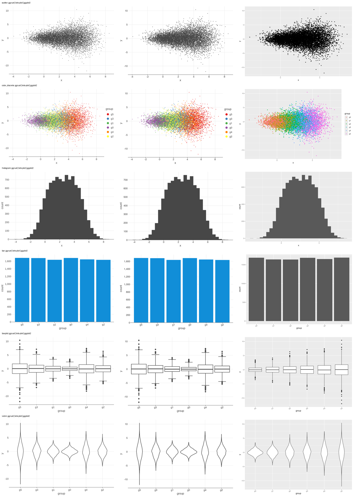
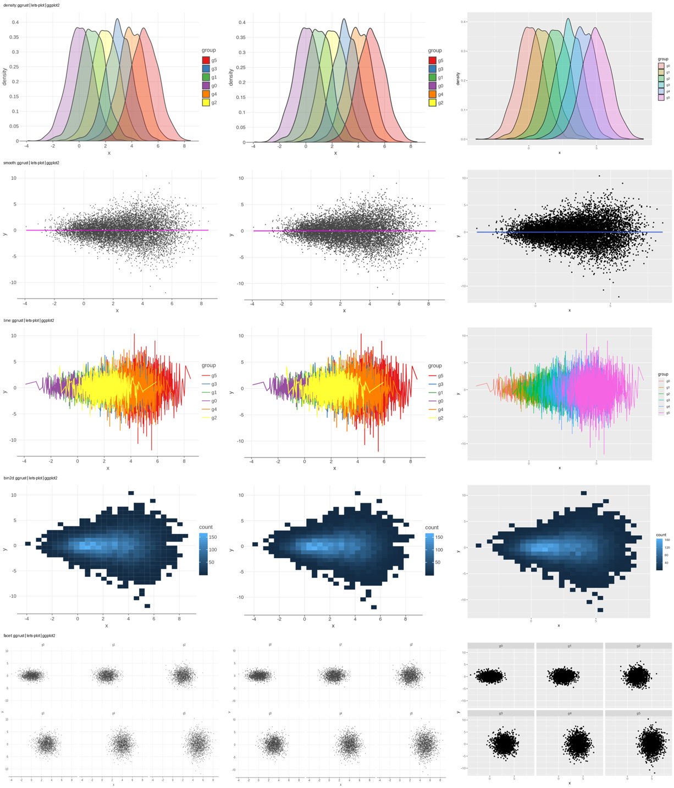

# Benchmarks

*November 2026. ggrust main (after 0.8.0), ggplot2 4.0.1, lets-plot 4.11.0.*

ggrust does the heavy work of a plot (stats, scales, layout, rendering) in Rust. Here is
what that buys you compared with the two libraries people usually reach for: R's
**ggplot2**, the reference grammar of graphics, and **lets-plot**, whose Python API ggrust
follows. We ran 11 everyday plots at 10k, 100k and 1M rows, saved each as SVG and PNG,
and measured time and memory. Every chart on this page uses linear axes and was drawn by
ggrust.


At 1M rows the typical plot takes **65 ms** in ggrust, **334 ms** in ggplot2 and **5.9 s**
in lets-plot, and ggrust needs 4x less memory than ggplot2 and 7.5x less than lets-plot.
ggrust is faster than both in **all 66 cases**.

## Summary

Total time for all 11 plots, and the median peak memory per plot. *Factor* is the time
divided by ggrust's.

=== "1M rows"

    | library | SVG total | factor | PNG total | factor | memory per plot |
    |---|---:|---:|---:|---:|---:|
    | **ggrust** main | **0.91 s** | **1.0** | **2.85 s** | **1.0** | **138 MB** |
    | ggplot2 4.0.1 | 9.67 s | 10.6 | 25.0 s | 8.8 | 560 MB |
    | lets-plot 4.11.0 | 71.6 s | 78.9 | > 495 s | > 174 | 1.0 GB |

    lets-plot did not finish the 1M-row line PNG within 300 s; it counts as 300 s here.

=== "100k rows"

    | library | SVG total | factor | PNG total | factor | memory per plot |
    |---|---:|---:|---:|---:|---:|
    | **ggrust** main | **0.10 s** | **1.0** | **0.42 s** | **1.0** | **30 MB** |
    | ggplot2 4.0.1 | 1.66 s | 16.5 | 3.23 s | 7.8 | 121 MB |
    | lets-plot 4.11.0 | 6.55 s | 65.3 | 46.3 s | 111.1 | 248 MB |

=== "10k rows"

    | library | SVG total | factor | PNG total | factor | memory per plot |
    |---|---:|---:|---:|---:|---:|
    | **ggrust** main | **0.02 s** | **1.0** | **0.14 s** | **1.0** | **18 MB** |
    | ggplot2 4.0.1 | 0.86 s | 34.6 | 1.17 s | 8.2 | 36 MB |
    | lets-plot 4.11.0 | 0.95 s | 38.2 | 8.41 s | 58.8 | 128 MB |

## Rules

A benchmark is only as good as its fairness. Every library does the same work:

- **Same data.** One CSV per size, read before the clock starts (polars in Python,
  `data.table::fread` in R). Reading is not timed.
- **Every row drawn.** lets-plot silently samples large layers by default (a scatter
  draws at most 100k points), so it runs with `sampling="none"`. ggrust and ggplot2
  never sample.
- **Same output.** 600 x 400 px; PNG at scale 2 (1200 x 800 px). R uses the devices
  `ggsave` picks: svglite for SVG and ragg for PNG.
- **The whole job is timed.** From building the plot object to the file on disk:
  stats, scales, layout, rendering and writing.
- **Fresh processes.** Each library, plot, size and format runs in its own process.
  Reported time is the median of three warm renders after a first, cold one.
- **Memory** is the peak resident memory of that process minus its memory after
  imports and data load, so it covers everything rendering allocates.

## The plots

The data looks like everyday data: two numeric columns (`x`, `y`) of shifted, widening
normals and a 6-level `group` column.

| plot | spec | what it stresses |
|---|---|---|
| scatter | `geom_point(size=1)` | one mark per row |
| color_discrete | `geom_point(size=1)`, `color="group"` | marks, discrete scale, legend |
| histogram | `geom_histogram(bins=30)` | binning stat |
| bar | `geom_bar()` on `group` | counting stat, discrete axis |
| boxplot | `geom_boxplot()` by group | quantiles and outliers |
| violin | `geom_violin()` by group | a kernel density per group |
| density | `geom_density(alpha=0.3)`, `fill="group"` | densities, overlapping transparent fills |
| smooth | points + `geom_smooth(method="lm")` | marks and a model fit with its band |
| line | `geom_line()`, `color="group"` | sorting, very long lines |
| bin2d | `geom_bin2d(bins=30)` | 2D binning, continuous fill scale |
| facet | points + `facet_wrap("group", ncol=3)` | 6 panels |

All three libraries draw the same picture: the same bins, quartiles, densities, fits
and panels. The visible differences are each library's default style (ggplot2's grey
theme, its larger points at `size=1` and its alphabetical group order).

??? note "Show the outputs side by side (10k rows: ggrust, lets-plot, ggplot2)"

    

    

## Results

### Time

Each panel has its own linear axis, so you can read every plot's gap.

=== "PNG"

    
    

=== "SVG"

    
    

Plots that draw a mark per row (scatter, smooth, facet) gain the most: at 1M rows ggrust
writes the PNG in 0.12 to 0.14 s, ggplot2 in 4.2 to 4.7 s and lets-plot in 40 to 46 s.
Stat plots (histogram, bar, boxplot, violin, density, bin2d) draw few marks, so the stat
dominates. R's stats are vectorised C, which makes this where ggplot2 comes closest:
ggrust is 5x to 16x faster at 1M rows.

### Memory

=== "PNG"

    
    

=== "SVG"

    
    

Data crosses into Rust once, as Arrow, and is not copied into a JSON spec. A 1M-point
scatter PNG peaks 52 MB above the data in ggrust, 761 MB in ggplot2 and 8.0 GB in
lets-plot.

### As data grows


## A fix this benchmark found

The first run had one weak spot: **line charts saved as PNG with 100k rows or more.**
The `line` plot draws 6 lines of about 166k vertices each at 1M rows, zigzagging across
the whole panel, and ggrust took 17.3 s for the PNG (ggplot2 5.4 s). The SVG was fast, so
the cost was rasterising very long anti-aliased lines in one piece. ggrust now strokes
long lines in chunks, with the same picture: the 1M-row line PNG takes **2.0 s** (2.7x
faster than ggplot2) and the 100k-row one 0.23 s (ggplot2 0.54 s). The numbers on this
page include the fix.

## Setup

- **Machine.** Apple M4 Pro (12 cores), 24 GB memory, macOS 27.
- **Python.** Python 3.14, ggrust main at commit `a3e895a` (0.8.0 plus the line fix,
  release build), lets-plot 4.11.0, polars.
- **R.** R 4.5.2, ggplot2 4.0.1, svglite 2.2.2, ragg 1.5.0, data.table.
- **Not measured.** Interactive HTML (lets-plot renders it in the browser, and ggplot2
  has no equivalent), notebook display and PDF.

## Reproduce

The scripts live in the repository's
[`benchmarks/`](https://github.com/datavil/ggrust/tree/main/benchmarks) folder:
`three_way.py` drives the runs, `three_way.R` is the ggplot2 worker and
`three_way_charts.py` draws the charts on this page. Raw numbers and the full table are
in [`REPORT-three-way.md`](https://github.com/datavil/ggrust/blob/main/benchmarks/REPORT-three-way.md).

```bash
uv run python benchmarks/three_way.py --work /tmp/ggrust-bench
uv run python benchmarks/three_way_charts.py benchmarks/results/three-way-<stamp>.json
```

The full run takes about 45 minutes, most of it lets-plot at 1M rows. Pull requests that
make any of the three libraries faster or the comparison fairer are welcome.
