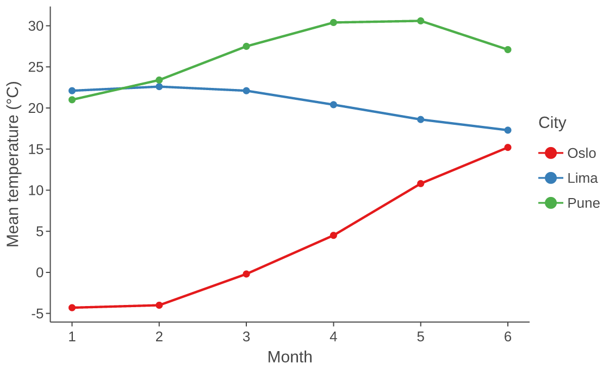

# ggrust

ggrust is a grammar-of-graphics plotting library written in Rust and used from Python.
Its Python API is a subset of [lets-plot](https://lets-plot.org)'s: `ggplot`, `aes`,
`geom_*`, `scale_*`, `theme`, `gggrid` and `+` composition work the same way.
Rust does the heavy work (stats, scales, layout, rendering). Data crosses from Python
to Rust once, as Arrow, so polars, pandas, pyarrow and dicts of numpy arrays all work.

Outputs: SVG, PNG, PDF and interactive HTML with tooltips and zoom/pan. Plots render
inline in Jupyter notebooks.

## Install

```bash
pip install ggrust
```

Wheels are published for Linux (x86_64, aarch64), macOS (Intel, Apple silicon) and
Windows (x64), for Python 3.11 and newer.

## A first plot

```python
import polars as pl
import ggrust as gg

frame = pl.DataFrame(
    {
        "city": ["Oslo"] * 6 + ["Lima"] * 6 + ["Pune"] * 6,
        "month": list(range(1, 7)) * 3,
        "temperature": [
            -4.3,
            -4.0,
            -0.2,
            4.5,
            10.8,
            15.2,
            22.1,
            22.6,
            22.1,
            20.4,
            18.6,
            17.3,
            21.0,
            23.4,
            27.5,
            30.4,
            30.6,
            27.1,
        ],
    }
)

plot = (
    gg.ggplot(frame, gg.aes("month", "temperature", color="city"))
    + gg.geom_line(size=1)
    + gg.geom_point(size=3)
    + gg.scale_color_brewer(palette="Set1")
    + gg.labs(x="Month", y="Mean temperature (°C)", color="City")
    + gg.theme_classic()
    + gg.ggsize(560, 340)
)
plot  # shows the interactive plot in a notebook
```



## Export

```python
plot.to_svg("weather.svg")
plot.to_png("weather.png", scale=2)
plot.to_html("weather.html")
gg.ggsave(plot, "weather.pdf")  # the extension picks the format
```

## Where next

- [Migrating from lets-plot](migration.md): what changes when you swap the import.
- [API reference](reference/plot.md): every public function, with its parameters.
